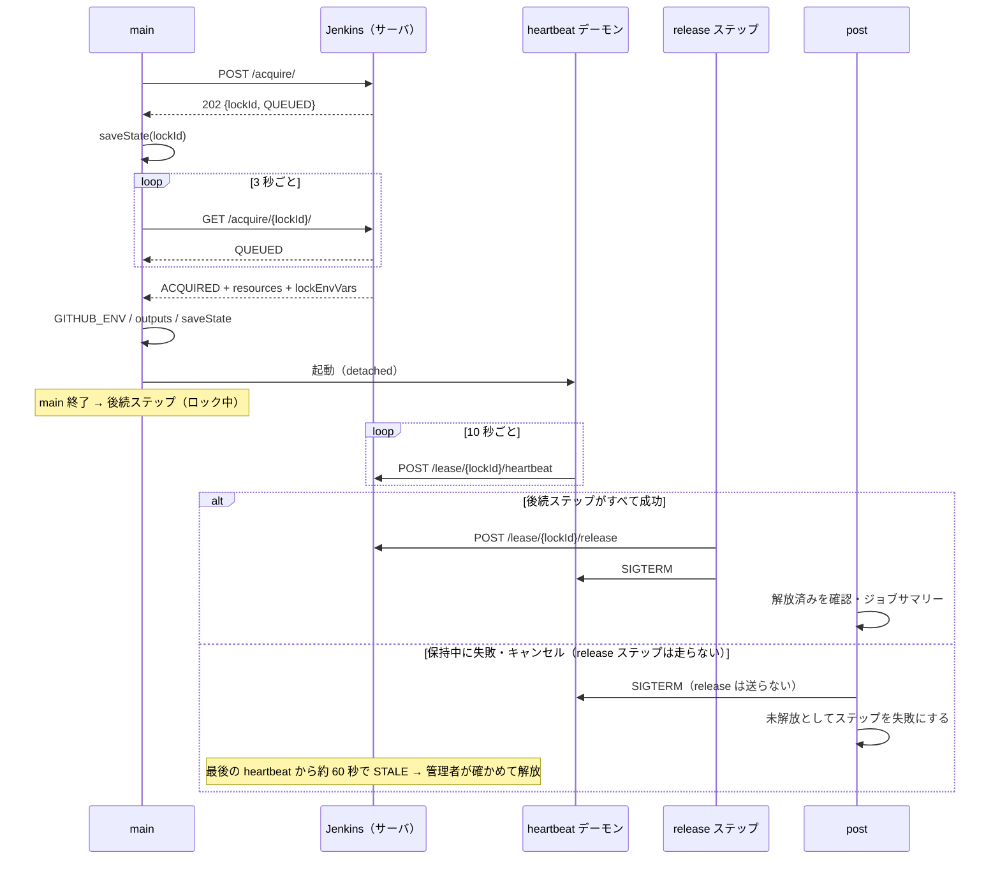

# Remote Lockable Resources クライアント（GitHub Actions）実装プラン

- 作成: 2026-11-24
- 状態: 実装中。2026-11-25 に M1・M2 を実装し、main にマージした（PR #1。単体テストと偽サーバの結合テストが通る）。
  2026-11-26 に M0 の PoC を GitHub ホストランナーで走らせ、設計の前提がすべて成り立つことを確かめた（§12）。次は M3（E2E）
- 基準: `jenkinsci/lockable-resources-plugin` upstream master
  [`82532cd`](https://github.com/jenkinsci/lockable-resources-plugin/tree/82532cdd3585ebefb06241c04aaf6201b4acb5b3)（2026-11-23）

---

## 1. 目的とスコープ

Jenkins の lockable-resources-plugin に組み込まれた Remote Lockable Resources のクライアント機能を、
GitHub Actions のワークフローから使えるようにする。Jenkins コントローラが持つリソース（実機、検証環境、
ライセンスなど）を、Jenkins のパイプラインと GitHub Actions のジョブが**同じキューで**取り合えるようにする。

GitHub Actions の `concurrency:` はリポジトリやワークフローの中でしか効かず、Jenkins 側のロックとは連動しない。
この Action はサーバ（Jenkins）のキューに直接並ぶので、Jenkins の `lock()` と同じ順序規則（priority /
inversePrecedence）と同じ排他で動く。

### やること

- 1 台のサーバに対する acquire → 待機 → heartbeat → release
- `lock()` のロック選択パラメータ（resource / label / group / quantity / extra ほか）をそのまま渡す
- サーバが返す `lockEnvVars` を後続ステップの環境変数にする
- workflow に明示的に書く release ステップによる解放。保持中にジョブが失敗・キャンセルされたら解放せず、
  サーバ側で STALE にする（§4.1）

### やらないこと

- peer mode（ロックごとに接続先を選ぶ、複数サーバ）。§2 参照
- `shareId`（プラグインでも delegated mode では使えない）
- ジョブをまたぐロック
- サーバ側の操作（リソース定義、STALE リースの解放など）。Jenkins の画面で行う

---

## 2. 「delegate mode 専用」の定義

Jenkins クライアントには 2 つの動作モードがある。

| | peer mode | delegated mode |
|---|---|---|
| 有効化 | `lock(..., serverId: 'X')` | `forcedServerId` を設定 |
| 接続先を決める人 | パイプライン作者（ロックごと） | 管理者（コントローラにつき 1 つ） |
| `serverId` を書かない `lock()` | ローカルのリソースをロック | 強制先のサーバへ送る |
| パイプラインが書いた `serverId` | そのサーバへ送る | 無視して強制先へ送る（ビルドログに INFO） |
| `shareId` | `serverId` と併用不可 | 使えない |
| `requireDistinctResources` などのサーバ設定 | 解決したサーバの設定に従う | 同左 |

この Action は delegated mode の動作だけを持つ。具体的には次のとおり。

1. **接続先は 1 つ**。接続の入力は `server-url` / `username` / `token` の組だけで、`server-id` という概念を持たない。
   複数リモートの定義やロックごとの振り分けは実装しない。
2. **すべてのロックがその接続先へ行く**。GitHub Actions にはローカルのリソースが無いので、振り替え先も無い。
3. **要求に載せるのはロックの意味を決めるフィールドだけ**。プラグインの `RemoteLockRequest` が
   「serverId / forcedServerId は転送の設定であってロックの意味ではない」として除外しているのと同じ線引き。
4. **`shareId` は受け付けない**（delegated mode と同じ制約）。
5. **fail closed**。サーバに届かない、要求が拒否された、といった場合はステップを失敗させ、ロック無しでは先へ進ませない。

### 管理者が接続先を決める部分について

Jenkins の `forcedServerId` はコントローラ管理者の設定で、パイプラインからは外せない。GitHub Actions では
ワークフロー作者がすべての入力を書けるので、同じ強制はできない。代わりに次の 2 段で近づける。

- **既定の構成**: 接続先 URL とユーザー名を組織（またはリポジトリ）の Variables に置き、Action は入力が空なら
  環境変数から読む（§5.1）。接続先をワークフローごとに書き散らさないための約束で、強制ではない。README に明記する。
- **より強い構成（任意）**: 組織が接続先を固定した薄いラッパー（composite action）を社内に公開し、
  ワークフローにはロックの入力だけを書かせる。`forcedServerId` に最も近い形。composite の中で使った
  JavaScript action の post も走ることは M0 で確かめた（§12）。

---

## 3. 使うサーバ API

ベースパスは `<server-url>/lockable-resources/remote/v1`。認証は Basic（ユーザー名＋API トークン）。
API トークンなら CSRF crumb は要らない（パスワードだと crumb 検査で 403 になる）。

| 用途 | メソッドとパス | 主な応答 |
|---|---|---|
| 取得要求 | `POST /acquire/` | 202 `{lockId, state}`、400 / 403 / 404 / 413、503 `ACQUIRES_PAUSED` |
| 状態確認 | `GET /acquire/{lockId}/` | 200 `{lockId, state, errorCode?, resources?, lockEnvVars?}`、404 `LOCK_NOT_FOUND` |
| 生存通知 | `POST /lease/{lockId}/heartbeat` | 204、410 `LOCK_STALE`、410 `LOCK_NOT_FOUND` |
| 解放 | `POST /lease/{lockId}/release` | 204（冪等。QUEUED の要求も取り消せる） |
| 一覧 | `GET /resources/` | MVP では使わない（§13） |

サーバ側の時間の決まり（クライアントからは変えられない）:

- heartbeat が 60 秒途絶えると `STALE` になる（判定は 1 秒ごと）。**自動では解放しない**（管理者が画面から解放する）
- ただし `release` エンドポイントは STALE の lease も解放する。lockId と RemoteUse のトークンがあれば
  API からも外せるので、「STALE は管理者が解放する」はサーバ側では強制されていない（§4.1）
- SKIPPED / FAILED の記録は終端になってから 120 秒で消える
- QUEUED はポーリングで延命されない。待ちの期限は `timeoutForAllocateResource` だけで決まる

Jenkins クライアントの定数（[`RemoteClientDefaults`](https://github.com/jenkinsci/lockable-resources-plugin/blob/82532cdd3585ebefb06241c04aaf6201b4acb5b3/src/main/java/org/jenkins/plugins/lockableresources/remote/RemoteClientDefaults.java)）は
この Action でも同じ値にする。

| 定数 | 値 |
|---|---|
| ポーリング間隔 | 3 秒 |
| heartbeat 間隔 | 10 秒（acquire の `heartbeatIntervalSeconds` にも 10 を送る。サーバは検証するだけで使わない） |
| 1 リクエストのタイムアウト | 5 秒 |
| ポーリング連続失敗の上限 | 20 回（約 60 秒） |

### 対応するサーバ版

**1560.va_b_cd589f23eb_ 以上**。`ACQUIRES_PAUSED` / `INVALID_FIELD_VALUE` / `LOCK_STALE` と
状態応答の `resources` が揃うのはこの版から（1554 には `LOCK_STALE` しか無いことをタグで確認した）。
`group` 入力を使う場合は 1588 以上（Resource groups #1100）。

### サーバ側の準備

プラグイン README の手順のまま。Remote API を有効にし、Expose label を設定し、
**Lockable Resources / RemoteUse** 権限を持つ専用ユーザーと API トークンを用意する。
Overall/Read も要るかどうかは E2E で確かめて README に書く。

---

## 4. 設計

### 4.1 解放の方針

**解放は workflow に書く release ステップだけが行う。post では解放しない。**

ロックを持っている間にジョブが失敗・キャンセルされたら、Action はリソースを手放さず、heartbeat だけを止める。
サーバは最後の heartbeat から約 60 秒で lease を `STALE` にする。そのあとは管理者が実機の状態を確かめてから、
画面で解放する。

失敗したジョブが実機をどんな状態で残したかは、クライアントには分からない。だから次の要求者に渡す前に人が確かめる。
サーバが STALE を自動で解放しない理由（黙ったクライアントがまだハードウェアを動かしているかもしれない）と同じ考え方である。

**Jenkins の `lock()` との違い**: Jenkins では、ブロックが失敗しても終わった時点で release される。
この Action では、保持中の失敗は STALE になる。

**「保持」の始まり**: main が ACQUIRED を workflow に引き渡した時点、つまり環境変数と出力を出し、デーモンを起動して
main が成功で終わった時点から保持とする。それより前の段階では、どのステップもリソースに触れていない。
QUEUED のまま待っている間や、引き渡し前に main が失敗した場合がこれに当たる。この段階では main（シグナル受信時）と
post が**要求を取り下げる**（`release` エンドポイントは QUEUED も取り消せる）。取り下げないと、要求が後で ACQUIRED に
昇格して heartbeat が無いまま STALE になり、誰も使っていないリソースのために管理者の手が要る。
取り下げの直前に昇格していた場合も release で解放されるが、どのステップもまだ触れていないので問題ない。

**release ステップの `if:` で方針を選べる**:

| release ステップの条件 | 前のステップが失敗・キャンセルされたとき |
|---|---|
| 指定なし（`success()` と同じ） | release ステップは走らない → STALE（本書の既定・推奨） |
| `if: always()` | release される（Jenkins の `lock()` と同じ） |

README では既定を勧める。`always()` は、失敗後に実機を確かめる必要がない用途に限って使うよう書く。

**STALE を API で外せる点**（§3）: release ステップは解放の前に `GET /acquire/{lockId}/` で状態を確かめ、
STALE なら解放せずに失敗させる（§14 の 6、2026-11-25 決定）。例えば途中でデーモンが落ちて STALE になり、
後続ステップは成功した場合がこれに当たる。状態応答は STALE の lease に `state: "STALE"` を返す
（Jenkins クライアントの `RemoteAcquireState` には STALE が無く UNKNOWN になるが、この Action は STALE として読む）。
確かめてから release を送るまでの間に STALE になる隙間は残るが、その間もデーモンは heartbeat を送り続けているので実際には起きにくい。

### 4.2 ロックの範囲

`lock()` はブロックを囲む。GitHub Actions のステップは囲めないので、この Action は
**取得したステップから release ステップまで**をロック範囲にする。release ステップは必須で、書き忘れると
post がジョブを失敗にする（lease は STALE になる）。

```yaml
jobs:
  flash:
    runs-on: [self-hosted, lab]
    env:
      LOCKABLE_RESOURCES_SERVER_URL: ${{ vars.LOCKABLE_RESOURCES_SERVER_URL }}
      LOCKABLE_RESOURCES_USERNAME: ${{ vars.LOCKABLE_RESOURCES_USERNAME }}
    steps:
      - uses: kohtaro-satoh/lockable-resources-remote-client-actions@v1
        id: lock
        with:
          token: ${{ secrets.LOCKABLE_RESOURCES_TOKEN }}
          label: plc
          quantity: 1
          variable: PLC
          timeout-for-allocate-resource: 30

      - run: ./flash.sh "$PLC0"          # ロック中

      # 必須。if: を書かなければ、前のステップが失敗したときは走らず、lease は STALE になる
      - uses: kohtaro-satoh/lockable-resources-remote-client-actions/release@v1
        with:
          token: ${{ secrets.LOCKABLE_RESOURCES_TOKEN }}
          lock-id: ${{ steps.lock.outputs.lock-id }}

      - run: ./report.sh                  # 解放後
```

### 4.3 構成要素

| 要素 | 実体 | 役割 |
|---|---|---|
| main | `action.yml` の `runs.main` | 入力の検証 → acquire → ポーリング → ACQUIRED なら環境変数と出力を出し、heartbeat デーモンを起動して終了。引き渡し前に失敗・キャンセルされたら要求を取り下げる |
| heartbeat デーモン | main が detached で起動する Node プロセス | 10 秒ごとに heartbeat を送る。ログはファイル（`$RUNNER_TEMP` 配下）に書く |
| release サブアクション（必須） | `release/action.yml` | release を送る（一時的な失敗は再送）→ 成功したらデーモンを止める。再送しきれなければデーモンを止めて失敗する |
| post | `action.yml` の `runs.post`（`post-if: always()`） | **解放しない**。デーモンが動いていれば止める（→ STALE）。引き渡し前の要求は取り下げる。保持したまま release されていなければステップを失敗にする。ジョブサマリーを出す |

release サブアクションが、release を送ってからデーモンを止める順にしている理由: 再送している間も heartbeat が続くので、
一時的な通信断の間に lease が STALE になることがない。

**heartbeat を別プロセスにする理由**: JavaScript action のプロセスはそのステップの終了とともに終わるが、
ロック中に動くのは後続のステップである。ステップをまたいで heartbeat を送り続けるには、ステップの外で
生きているプロセスが要る。ランナーは孤児プロセスをジョブの終わり（`Complete job`）でまとめて片付けるので、
post が止め損ねても残り続けることはない。この前提は M0 の PoC で確かめた（§12。container ジョブでは
片付けの代わりに、ジョブの終わりにコンテナごと消される）。

post がデーモンを止めるのは、失敗時に STALE へ確実に落とすためでもある。止めなければ、ランナーの片付けまで
heartbeat が続く。

composite action は post を持てないため、JavaScript action にする。

**デーモンの起動と停止（実装で決めたこと）**:

- 最初の heartbeat は起動直後に送る（Jenkins クライアントは 10 秒後）。main はこの 1 回目を送り終えるまで待ち、
  デーモンが起動できなかった、または 410 が返ったときは引き渡し前の失敗として扱う（要求を取り下げる）
- 停止は協調式にする。release / post は停止ファイル（`<lockId>.stop`）を置き、デーモンが状態ファイルに
  `stoppedAt` を書くのを待つ。デーモンは 250 ms ごとに停止ファイルを見て、送信中の heartbeat も打ち切る。
  `stoppedAt` を書いた後は 1 回も送らない。シグナルで止めるのは応答が無いときだけで、PID がまだデーモンのものか
  （Linux は `/proc/<pid>/cmdline`、macOS は `ps`）を確かめてから送る。PID は再利用されるため。Windows では確かめる手段が
  無いので送らず、ランナーの片付けに任せる
- デーモンは環境変数を引き継ぐ（`INPUT_*` と `STATE_*` は除く）。ランナーが孤児プロセスを見つける
  `RUNNER_TRACKING_ID` を消さないため（main の環境にあることは M0 で確かめた。container ジョブのコンテナの中には無い）
- 安全網として、デーモンは lock の状態ファイルが消えたら（`RUNNER_TEMP` はジョブの終わりに空になる）、
  または段階が `enqueued` / `held` 以外になったら自分で止まる。ランナーの片付けが効かなくても lease を生かし続けない
- release を送ってからデーモンを止めるまでの間に heartbeat が出ると 410 `LOCK_NOT_FOUND` が返る。
  release を送り始めた後の 410 は想定どおりなので警告にしない

### 4.4 シーケンス



### 4.5 ステップ間で受け渡す状態

`core.saveState` は同じ action の main と post の間でしか共有されない。release サブアクションは別の action なので、
main は lockId ごとの状態ファイル `$RUNNER_TEMP/lockable-resources/<lockId>.json` を書き、release と post はこれを読み書きする。
`RUNNER_TEMP` はジョブの終わりに消える。

状態ファイルに置くもの: 段階（`enqueued` / `held` / `skipped` / `released` / `withdrawn` / `stale`）、デーモンの PID、
デーモンのログのパス、取得時刻、書いたステップの `GITHUB_ACTION`、release ステップが失敗したときの理由。
`core.saveState` には lockId と状態ファイルのパスだけを置く。`stale` は release ステップが STALE を見つけて
解放しなかった段階（§14 の 6）。デーモンは別ファイル（`<lockId>.heartbeat.json`）に送信の成否を書く。

- **saveState が post に届かなかったとき**（main がキャンセルで殺された場合など）は、post が状態ファイルを
  `GITHUB_ACTION` で探す。同じジョブの中でステップごとに一意な値なので、別のロックの状態を拾わない
  （main と post で同じ値になることは M0 で確かめた。M0 では saveState がいつも post に届いた）

- **lockId は受理された直後に保存する**。待機中にキャンセルされても post が取り下げられるようにするため
- **token は state にも状態ファイルにも入れない**。release、post、デーモンは入力（または環境変数）から読み直す
- デーモンには token を**環境変数で**渡す。コマンドライン引数に載せると `ps` で見える

---

## 5. 入力と出力

入力名は GitHub Actions の慣習に合わせて kebab-case にする（§14 の未決事項 1）。

### 5.1 接続

| 入力 | 必須 | 入力が空のとき | 説明 |
|---|---|---|---|
| `server-url` | ○ | 環境変数 `LOCKABLE_RESOURCES_SERVER_URL` | サーバのルート URL（コンテキストパスを含む） |
| `username` | ○ | 環境変数 `LOCKABLE_RESOURCES_USERNAME` | RemoteUse 権限を持つユーザー |
| `token` | ○ | **読み替えない** | API トークン。パスワードは不可 |
| `client-id` | | `github-actions:<owner>/<repo>` | サーバの画面でロックの横に出る識別子 |

`token` だけは環境変数から読まない。ジョブの `env:` に置くと、ほかのすべてのステップ（他者の action を含む）
から見えてしまうため、`with:` で毎回渡させる。

### 5.2 ロックの要求

対応関係と「いつ JSON に載せるか」は、Jenkins クライアントの
[`RemoteApiClient.buildLockRequestJson`](https://github.com/jenkinsci/lockable-resources-plugin/blob/82532cdd3585ebefb06241c04aaf6201b4acb5b3/src/main/java/org/jenkins/plugins/lockableresources/remote/RemoteApiClient.java)
と同じにする。違いは `priority` と `reason` の 2 か所だけで、どちらも理由を書いておく。

| 入力 | `lock()` | JSON に載せる条件 | 既定 |
|---|---|---|---|
| `resource` | `resource` | 空でない | — |
| `label` | `label` | 空でない | — |
| `group` | `group` | `group` / `resource` / `label` / `extra` のどれかがあるとき（サーバ 1588 以上で意味を持つ） | 空なら `common` |
| `quantity` | `quantity` | 正の値 | 0（label に合うものすべて） |
| `variable` | `variable` | 空でない | — |
| `inverse-precedence` | `inversePrecedence` | 常に | `false` |
| `resource-select-strategy` | `resourceSelectStrategy` | 常に | `SEQUENTIAL` |
| `skip-if-locked` | `skipIfLocked` | 常に | `false` |
| `extra` | `extra` | 1 件以上 | — |
| `priority` | `priority` | **0 以外**（Jenkins クライアントは正の値だけ。§11） | 0 |
| `timeout-for-allocate-resource` | `timeoutForAllocateResource` | 正の値 | 0（無期限） |
| `timeout-unit` | `timeoutUnit` | 常に | `MINUTES` |
| `reason` | `reason` | 常に | 空なら自動で補う（下記） |

- **`group` の既定値**: Jenkins クライアントは `normalizeGroup` を通すので、group を書かなくても
  resource / label / extra があれば `"group": "common"` を送る。サーバは extra の検証で生の group を見る
  （extra の要素が resource も label も持たないとき、要求の group が無ければ 400 `INVALID_EXTRA`）ので、
  送らないと等価にならない。この Action も同じく `common` を送る。1560 のサーバは `group` を読まないので無害
  （タグ `1560.va_b_cd589f23eb_` で確認した）
- **`resourceSelectStrategy`** は大文字にして送る（サーバも大文字にしてから解釈する）
- **`reason` の自動補完**: 入力が空なら `<workflow> #<run_number> (<job>) <run URL>` を入れる。サーバの画面は
  リモートのロックに clientId と reason を出すので、これが無いと管理者はどの実行が持っているか辿れない（§14 の未決事項 2）。
- **`extra`** は YAML（JSON も可）のリストで書く。キーは `lock()` の extra と同じ `resource` / `label` /
  `quantity` / `group` だけで、それ以外のキー（`labels` などの書き間違い）はエラーにする。

  ```yaml
  extra: |
    - resource: resource4
    - label: gpu
      quantity: 2
  ```

- **クライアント側で検証するのは型と書式だけ**（整数、真偽値、`timeout-unit` と `resource-select-strategy` の
  列挙値、`extra` の構文）。「resource と label の併用」「priority と inversePrecedence の併用」「対象なし」の
  判定はサーバに任せる。対象なしを許すかはサーバの `allowEmptyOrNullValues` 設定で変わり、クライアントからは
  分からない。サーバはローカルの `lock()` と同じ文言で 400 `INVALID_REQUEST` を返すので、それをそのまま表示する。
- `server-id` / `share-id` という入力は定義しない。書かれた場合はランナーが「Unexpected input」の警告を出す。

### 5.3 出力と環境変数

| 出力 | 内容 |
|---|---|
| `lock-id` | サーバが発行した lockId |
| `state` | `ACQUIRED` または `SKIPPED` |
| `acquired` | `true` / `false` |
| `resources` | 取得したリソース名の JSON 配列 |
| `env-vars` | サーバが返した `lockEnvVars` の JSON |

- `lockEnvVars` の各項目（`PLC`、`PLC0`、`PLC0_X`、`PLC_X` …。X はプロパティ名。`PLC_X` は 1 つ目のリソースのプロパティ）を `GITHUB_ENV` に書き、後続ステップの
  環境変数にする。サーバは `variable` を指定したときだけ名前を載せる。
- `variable` が `GITHUB_` / `RUNNER_` で始まる場合はエラーにする。GitHub はこれらの変数の上書きを受け付けない。
- プロパティの値はログに出さない（秘密を入れる運用がありうる）。

### 5.4 release サブアクションの入力

| 入力 | 必須 | 説明 |
|---|---|---|
| `lock-id` | ○ | 取得ステップの出力 `lock-id` |
| `server-url` / `username` / `token` | ○ | §5.1 と同じ（同じ読み替え規則） |

- 状態ファイルが `skipped` なら何もせず成功する（SKIPPED の lockId をそのまま渡せるように）。
- release が一時的に失敗したら 3 秒間隔で再送する（上限は §14 の 5）。204 が返れば成功で、デーモンを止める。
- 状態ファイルが無い場合（別ジョブで取得した lockId など）は release だけを送る。ジョブをまたぐロックは対象外だが、
  手で後片付けする用途には使える。ただし STALE の lease は外さない（§4.1）。
- 解放の前の状態確認の結果ごとの扱い: STALE なら解放せずに失敗する。`FAILED` で errorCode が `RELEASED` なら
  解放済み（管理者が外した、など）として警告だけ出して成功する。404 / 410 ならサーバに記録が無いので警告を出し、
  release は送る（冪等）。状態確認の一時的な失敗も release と同じ回数だけ再送する。
- 再送するのは一時的な失敗（応答なし、5xx、408、429）だけ。401 / 403 などはすぐ失敗する。

### 5.5 ログとサマリー

- main: 要求の内容、lockId、状態の変化。待機中は 60 秒ごとに経過時間を出す（3 秒ごとに出すとログが埋まる）
- release: 保持時間、heartbeat の成否の集計
- post: 未解放の lease があれば、lockId・リソース名・STALE になる見込み時刻・管理者の解放が要ることをエラーで出す。
  デーモンのログの警告をアノテーションにし、`$GITHUB_STEP_SUMMARY` に表を出す

---

## 6. 失敗時の挙動

Jenkins クライアント（[`RemoteLockSession`](https://github.com/jenkinsci/lockable-resources-plugin/blob/82532cdd3585ebefb06241c04aaf6201b4acb5b3/src/main/java/org/jenkins/plugins/lockableresources/remote/RemoteLockSession.java)）と
同じにするのを原則とし、違う所は理由を書く。

| 事象 | Jenkins クライアント | この Action |
|---|---|---|
| acquire が 4xx | 失敗 | 失敗。errorCode とメッセージをそのまま出す |
| acquire が 503 `ACQUIRES_PAUSED` | 3 秒ごとに再送。allocate の期限で失敗 | 同じ |
| acquire で通信失敗・その他の 5xx | 失敗（fail closed） | 同じ |
| ポーリングで QUEUED | 待つ | 同じ |
| ポーリングで ACQUIRED | ブロックを実行 | 環境変数と出力を出し、デーモンを起動して成功で終わる |
| SKIPPED | ブロックを飛ばして成功 | 成功で `acquired=false`。後続ステップは `if:` で判断する（§7） |
| FAILED / EXPIRED / UNKNOWN / CANCELLED | 失敗 | 失敗（`LOCK_WAIT_TIMEOUT` などを表示） |
| ポーリングで 404 / 410 | 失敗 | 同じ |
| ポーリングの一時的な失敗 | 連続 20 回で失敗 | 同じ |
| heartbeat の失敗 | WARN を出して続行 | デーモンがログに記録して続行。post で警告を出す |
| heartbeat が 410（STALE / NOT_FOUND） | WARN を出して続行 | デーモンは送るのをやめて記録し、release / post で警告を出す。STALE から戻る経路は無いので送り続けても意味がない |
| 待機中のキャンセル | `stop()` で release | main が SIGINT / SIGTERM を受けて要求を取り下げる（猶予は Windows で約 7 秒、ほかで約 10 秒。§12）。post でも取り下げる（冪等） |
| 引き渡し前に main が失敗 | release しない | 要求を取り下げる（まだ保持していない。§4.1） |
| **保持中（後続ステップ）の失敗・キャンセル** | **ブロック終了で release** | **release しない**。post がデーモンを止め、約 60 秒後に STALE（§4.1。意図的な差分） |
| release ステップの書き忘れ | — | post がデーモンを止めてステップを失敗にする → STALE |
| release の失敗 | WARN | release ステップが再送する（その間も heartbeat は続く）。再送しきれなければデーモンを止めてステップを失敗にする → STALE |
| ランナーごと消える | — | 何もできない。QUEUED は allocate の期限まで残り、保持中なら約 60 秒後に STALE になる |

**ランナー消失への備え**: `timeout-for-allocate-resource` を付けることを README で強く勧める。
付けておけば QUEUED の残留は期限で消える。保持中の消失は、保持中の失敗と同じく STALE になる（§4.1 の方針どおり）。

---

## 7. GitHub Actions ならではの制約と使い方の決まり

- **ロックはジョブの中だけ**。ジョブは別のランナーで走るので、ジョブをまたいで持てない。
  複数ジョブで排他したいときは、それぞれのジョブで取得する。
- **release ステップはロックが要るステップすべての後に置く**。`if:` を書かなければ、前のステップが失敗したときは走らず
  STALE になる（§4.1）。
- **skip-if-locked**: SKIPPED でもステップは成功する。後続のステップは
  `if: steps.lock.outputs.acquired == 'true'` で分ける。release ステップは SKIPPED の lockId を受け取っても成功する。
- **`if: always()` / `if: failure()` のステップは、ロックが取れなかったときも走る**。ロックが要るステップには使わない。
- **同じジョブで同じリソースを 2 回取ると、2 回目が 1 回目を待ち続ける**（`shareId` が無いため）。期限を付ける。
- **複数のロック**: Action を複数回呼べる。release ステップもロックごとに書く。`variable` は別名にする。
- **待ち時間は課金時間とジョブの上限に含まれる**（GitHub ホストランナーは 6 時間）。止めるなら
  `timeout-for-allocate-resource` を使う。ステップの `timeout-minutes` でも止まるが、サーバの期限の方が
  `LOCK_WAIT_TIMEOUT` ではっきり終わる。
- **ネットワーク**: ランナーからサーバへ届く必要がある。社内の Jenkins なら self-hosted runner を使う。
- **fork からの PR** には secrets が渡らない。token が空なら、その旨を出してすぐ失敗する。

---

## 8. セキュリティ

- token は入力からだけ受け取り、`core.setSecret` でマスクする。state には保存しない。デーモンへは環境変数で渡す。
- `http://` の URL には警告を出す（Basic 認証が平文で流れる）。閉じた検証環境があるので拒否はしない。
- 自己署名証明書は `NODE_EXTRA_CA_CERTS` で対応し、README に書く。証明書検証を切るオプションは作らない。
- サーバ側は RemoteUse だけを持つ専用ユーザーにする（必要な最小権限は E2E で確定させる）。
- 依存は `@actions/core` と `js-yaml` に絞る。HTTP は Node 標準の `fetch` を使う。
- 利用者には、タグではなくコミット SHA での固定を README で勧める。

---

## 9. リポジトリ構成と技術

```
.
├── action.yml                 # ロック（main + post）
├── release/action.yml         # 解放（必須）。runs.main は ../dist/release.js
├── src/
│   ├── entry/                 # バンドルの入口（main / post / release / heartbeat）。@actions/core と実プロセスをつなぐだけ
│   ├── main.ts                # main の処理（取得 → 引き渡し、失敗時の取り下げ）
│   ├── post.ts                # post の処理（段階ごとの判断）
│   ├── release.ts             # release サブアクションの処理
│   ├── heartbeat.ts           # デーモンのループ
│   ├── daemon.ts              # デーモンの起動・停止
│   ├── client.ts              # REST クライアント（RemoteApiClient 相当）
│   ├── session.ts             # 取得の状態機械（RemoteLockSession 相当。時計と HTTP を差し替え可能にする）
│   ├── request.ts             # 入力 → lockRequest JSON（buildLockRequestJson 相当）
│   ├── inputs.ts              # 入力の読み取りと型の検証
│   ├── state.ts               # saveState のキー、状態ファイル
│   ├── retry.ts               # 一時的な失敗の再送
│   ├── io.ts / core-io.ts     # @actions/core の差し替え口と実装
│   └── defaults.ts            # RemoteClientDefaults 相当の定数
├── dist/                      # バンドル済み（コミットする）
├── __tests__/
│   ├── unit/                  # 単体テスト
│   ├── integration/           # dist を実プロセスで動かす結合テスト
│   └── support/               # 偽サーバ、ランナーの代役、fake
├── e2e/
│   ├── server/                # E2E 用 VPS の構築一式（Jenkins イメージ、init groovy、管理ジョブ、Caddy、版の切り替え）
│   └── tools/                 # e2e.yml が使う道具（サーバ状態の確認、管理ジョブの起動、判定）
├── .github/
│   ├── poc/                   # M0 の PoC 用の小さな action
│   └── workflows/
│       ├── ci.yml             # lint / test / dist の差分チェック / 3 OS の結合テスト
│       ├── m0-poc.yml         # M0 の PoC（手動実行）
│       ├── m0-poc-cancel.yml  # M0 の PoC のうちキャンセル系（手動実行）
│       └── e2e.yml            # VPS 上の実 Jenkins に対する E2E（M3、手動実行）
└── docs/
    └── PLAN.md                # 本書
```

- TypeScript 6.0（typescript-eslint と ts-jest がまだ 7 に対応していない）、`runs.using: node24`（GitHub ホストランナーでは M0 で確かめた。self-hosted runner は版による）
- 結合テストは環境変数 `LOCKABLE_RESOURCES_TEST_TIME_SCALE`（0 より大きく 1 以下）でクライアント側の間隔を縮めて速く回す。
  1 を超える値は無視するので、サーバの STALE 判定に対して遅くなることはない
- 構成は `actions/typescript-action` テンプレート（Rollup + Jest + ESLint + Prettier）に合わせる。
  バンドルの入口は main / post / release / デーモンの 4 つ
- HTTP のタイムアウトは `AbortSignal.timeout(5000)`
- ライセンス: MIT（プラグインと同じ）

---

## 10. テスト計画

### 10.1 単体テスト

- **`request.ts`**: 入力から JSON への対応を表で網羅する。**既定値・未指定・0・空文字・空白・負の値を必ず含める**
  （`quantity` の `''` / `'0'` / `'-1'`、`priority: '-1'`、`timeout-unit: ''`、`extra` の `''` / `'[]'`、
  `group` だけの要求）。期待値は Jenkins の `buildLockRequestJson` と一致させ、違う所（`priority`、`reason`）は
  専用のケースで固定する。
- **`session.ts`**: 偽の時計と偽の HTTP で状態機械を確かめる。QUEUED→ACQUIRED、SKIPPED、FAILED、
  503 の再送と期限、404 / 410、連続 19 回の失敗では続行し 20 回で失敗すること、待機中のキャンセルで取り下げること。
- **post の判断**: 段階ごとに、取り下げる（`enqueued`）・デーモンを止めて失敗にする（`held`）・何もしない
  （`released` / `skipped` / `withdrawn`）の 3 通りに分かれること。**`held` で release を送らないこと**を明示的に確かめる。
- **release の再送**: 一時的な失敗は上限まで再送し、成功したらデーモンを止める。上限を超えたらデーモンを止めて失敗する。
- **`inputs.ts`**: 型エラー、`GITHUB_` / `RUNNER_` で始まる `variable`、`extra` の未知のキー、token が空。

### 10.2 結合テスト（偽サーバ）

- Node の HTTP サーバでサーバ API の状態機械を再現する。プラグインの `RemoteServerFixture` と同じく、
  QUEUED からの遷移、終端状態、404 / 410、n 回連続の失敗、heartbeat の任意のステータス、503 を出せるようにする。
- main → デーモン → release → post を実プロセスで通す。デーモンが heartbeat を送り続けること、release の後に止まること、
  release がちょうど 1 回届くことを確かめる。
- 失敗系: main → デーモン → post（release を飛ばす）。post がデーモンを止め、**release が 1 回も届かず**、
  heartbeat が止まることを確かめる。

### 10.3 E2E（実 Jenkins × GitHub Actions）

（2026-11-26 改訂）当初はジョブごとに Jenkins を Docker で起動する案だったが、テスト専用の VPS に共有の Jenkins を
置く方式に変えた。別々のジョブが同じ Jenkins に届くので、ジョブ同士の取り合い（E06）、ジョブが終わった後の
STALE の確認（E09 など）、windows / macos から実 Jenkins を相手にすること（E14）が、模擬ではなく本物になる。
https・リバースプロキシ・コンテキストパスといった実運用に近い経路も通る。

#### 環境

| 項目 | 内容 |
|---|---|
| VPS | ConoHa、Ubuntu 26.04、メモリ 1 GB・2 コア・swap 3.8 GB。テストの間だけ動かす使い捨て |
| 公開 | `https://<E2E のホスト名>/jenkins/`（ホスト名はリポジトリに書かず、Variables とサーバ上の設定にだけ置く）。Caddy が Let's Encrypt で https を終端して Jenkins に中継する。Jenkins のポートは 127.0.0.1 にだけ開く（Docker の公開ポートは ufw を素通りするため） |
| Jenkins | LTS（JDK 21）を**同時に 1 つだけ**動かす。2 つ分のメモリが無いので、プラグイン 1560 と最新の 2 つのイメージと JENKINS_HOME を用意しておき、SSH 越しのスクリプトで切り替える（URL は同じ）。ヒープは 512 MB 前後 |
| プラグイン | lockable-resources（版を固定）、Pipeline の最小構成（`workflow-job`・`workflow-cps`・`workflow-basic-steps`。E07 の相手役）、`matrix-auth`、`groovy`（管理ジョブ）。メモリを節約するため JCasC は使わず init groovy で設定する |
| 設定 | remote API 有効、`exposeLabel` は `e2e`。ケースごとに専用のリソースを用意し、並列に走るケース同士が干渉しないようにする |
| 構築 | 手順は `e2e/server/` にスクリプトで置き、VPS を作り直しても再現できるようにする |

ユーザーと権限（global matrix）:

| ユーザー | 権限 | 用途 |
|---|---|---|
| `e2e-robot` | Overall/Read、Lockable Resources/RemoteUse | アクションが使う。README で勧める最小権限そのもの |
| `e2e-ops` | Overall/Read、Job/Read、Job/Build | 管理ジョブと相手役のパイプラインを起動する |
| `e2e-norights` | Overall/Read のみ | 403 の確認（E13） |
| `admin` | 全権 | SSH 越しの保守だけで使う。CI には渡さない |

**管理ジョブ（`e2e-admin`）**: テストには管理者の操作が要る（STALE の後片付け、`acceptNewAcquires` の切り替え、
監査ログや待ち行列の読み出し）。admin の token を CI に渡すと、漏れたときにスクリプトコンソール経由で VPS を
乗っ取られうる。そこで決まった操作だけをする Freestyle ジョブ（system Groovy）を置き、CI は `e2e-ops` で
`OP` パラメータを付けて起動し、結果をコンソール出力から読む。`e2e-ops` は Job/Configure を持たないので
スクリプトは変えられない。パラメータは許した値（`e2e-` で始まるリソース名など）だけを受け付ける。

| OP | 内容 |
|---|---|
| `version` | 動いている lockable-resources の版を返す。ワークフローの入力と照合する |
| `reset` | `e2e-` で始まるリソースのリモートの lease と待ちをすべて解放し、`acceptNewAcquires` を true に戻し、相手役のビルドを止める |
| `queue` | 指定したリソースを待っている要求の数 |
| `accept` | `acceptNewAcquires` を true / false にする |
| `release-stale` | STALE の lease を管理者として解放する（後片付け） |
| `audit` | 指定した時刻以降の監査ログ（`LRA|…` の行）を返す |

監査ログは、プラグインの `org.jenkins.plugins.lockableresources.audit` ロガー（1560 にもある）を FINE にして
ファイルに書かせる。資源が二重に保持されていないことはクライアントのログでは示せない（クライアントのログに出る
区間は実際の区間の部分集合）ので、この記録で判定する。

#### ワークフロー（`e2e.yml`）

- `workflow_dispatch` だけで走らせる。入力はプラグインの版（`1560` / `latest`）で、最初に `OP=version` と照合し、
  違えば止める
- `concurrency` で E2E の run を 1 本ずつにする（Jenkins は共有なので）
- 接続先と token はリポジトリの Variables / Secrets に置く（`E2E_SERVER_URL`、`E2E_ROBOT_TOKEN` など）。
  ホスト名をワークフローに書かない
- 段階:
  1. `preflight`: 版の照合、`OP=reset`、開始時刻の記録
  2. 並列: 下表で「並列」のジョブ
  3. 直列: E12。`acceptNewAcquires` を止めると全体に効くので、ほかと同時に走らせない
  4. `verify-failures`: 失敗系のジョブが出力した lockId について、サーバでの状態（STALE / 解放済み）を確かめる。
     最後に `OP=release-stale`
  5. `judge`: 各ジョブ・各ステップ（post を含む）の成否を API で取り、期待値の表と照合する。想定どおりに失敗する
     ジョブには job レベルの `continue-on-error` を付け、run 全体の緑・赤は judge で決まるようにする
  6. `cleanup`（`always()`）: `OP=reset`

#### ケース

| ID | 内容 | 確認すること | ランナー | 段階 |
|---|---|---|---|---|
| E01 | resource を指定して取得 → 後続ステップ → release | サーバで FREE に戻る。post は何もしない | ubuntu / windows / macos | 並列 |
| E02 | label + quantity + variable、プロパティ付きのリソース | `X`、`X0`…、`X0_<プロパティ名>`、`X_<プロパティ名>` が後続ステップで読め、`env-vars` 出力と一致する。プロパティの値がロックのステップのログに出ない（judge がログを取って調べる） | ubuntu / windows / macos | 並列 |
| E03 | extra（最新版では group も） | 全部まとめて取れる | ubuntu | 並列 |
| E04 | skip-if-locked（前のステップが保持中のリソース） | SKIPPED、`acquired=false`、`if:` で後続が飛ぶ | ubuntu | 並列 |
| E05 | allocate の期限（保持中のリソースを 20 秒の期限で要求） | `LOCK_WAIT_TIMEOUT` で失敗し、20 秒前後で終わる | ubuntu | 並列 |
| E06 | 4 ジョブが同じリソースを取り合う（それぞれ 20 秒保持） | 4 つとも取れる。監査ログで保持区間が重ならない | ubuntu ×2 / windows / macos | 並列 |
| E06p | 保持中のリソースを priority 0 と 10 の 2 ジョブが待つ | 10 が先に取れる | ubuntu ×3 | 並列 |
| E07 | Jenkins パイプラインが持つリソースを Actions が待つ。逆も | 同じキューで排他される（監査ログで順序と重なりを確かめる） | ubuntu | 並列 |
| E08 | 待機中にロックのステップを `timeout-minutes` で打ち切る | main がシグナルを受けて取り下げ、サーバに待ちが残らない（`OP=queue` が 0） | ubuntu / windows / macos | 並列 |
| E09 | 保持中に後続ステップが失敗する | release されず、ジョブの後に STALE | ubuntu | 並列 |
| E10 | 保持中に 75 秒かかる後続ステップ | STALE にならない（デーモンが生きている） | ubuntu / windows / macos | 並列 |
| E11 | release を書き忘れた成功ジョブ | post がジョブを失敗にし、STALE になる | ubuntu | 並列 |
| E12 | `acceptNewAcquires=false` にして要求し、30 秒後に再開する（再開は裏で起動しておく） | 503 の間待って、再開後に取れる | ubuntu | 直列 |
| E13 | 公開していないリソース、誤った token、RemoteUse の無いユーザー、http:// の URL（https へのリダイレクト）、誤ったコンテキストパス | 404 / 401 / 403 / リダイレクト / 404 で、ヒント付きですぐ失敗する | ubuntu | 並列 |
| E14 | — | E01・E02・E08・E10 を 3 OS で回すことで兼ねる | — | — |
| E15 | 保持中の後続ステップを `timeout-minutes` で打ち切る | E09 と同じく release されず STALE。run 全体のキャンセルでも post が走ることは M0 で確かめた | ubuntu | 並列 |
| E16 | release ステップに `if: always()`、保持中に後続ステップが失敗する | release され FREE に戻る（Jenkins の `lock()` と同じ挙動を選べる） | ubuntu | 並列 |
| E17 | 保持中にデーモンを殺し、70 秒待ってから release | release ステップが STALE を見つけ、解放せずに失敗する（§14 の 6） | ubuntu | 並列 |
| E18 | 保持中と release 中に、ランナー側の iptables でサーバへの通信を止める（保持中 30 秒、release 中 15 秒） | heartbeat の失敗は警告になるが lease は生き残る。release は再送して成功する（§14 の 5） | ubuntu | 並列 |

- ジョブの開始時刻は数十秒ずれる。順序を見るケース（E06p、E07）は、保持役がリソースを取ってから待ち手が要求し、
  保持役は `OP=queue` で待ちがそろうのを確かめてから解放する。開始時刻のずれに左右されない
- 想定どおりに失敗するのは E09・E11・E15・E16（後続ステップが失敗する）・E17。E05・E13 は失敗するステップを
  ステップ単位の `continue-on-error` で受け、結果と所要時間を確かめる
- 1 run の目安は 10〜15 分。プラグインの版を切り替えてもう 1 run 回す
- 並列のジョブは十数本になるが、サーバへの負荷は 3 秒ごとのポーリングと 10 秒ごとの heartbeat なので、
  1 GB の VPS でも問題にならない

#### やらないこと

- 優先度以外の並び順（inversePrecedence など）の網羅: サーバの責任で、プラグインのテストが持つ
- Jenkins の再起動をまたぐ挙動: lease の記録はメモリにあり、再起動で消える（プラグインの挙動）
- self-hosted runner の確認: 公開リポジトリで self-hosted runner を使うのは危ないので、この VPS には置かない

---

## 11. プラグイン側の気づき（コードを読んだだけで、まだ再現していない）

1. **負の `priority` がリモート経路で落ちる**。Jenkins クライアントは `priority` を正の値のときしか送らない
   （`buildLockRequestJson` の `if (lr.getPriority() > 0)`）。ローカルの `lock()` は負の値を受け付け
   （README の表に -1、-2 がある）、サーバも負の値を読める。そのためリモートでは負の priority が 0 として扱われる。
   この Action は 0 以外なら送る。プラグインに報告するのは E2E で再現してから。由来は `git log -S` で確かめる。
2. **ポーリングを諦めたときに要求を取り下げない**。サーバが生きていれば QUEUED の要求が残り、のちに ACQUIRED に昇格して、
   heartbeat が無いまま STALE で止まりうる。どのビルドも使っていないリソースに管理者の手が要る。
   この Action は引き渡し前の要求を取り下げる（§4.1）。

---

## 12. マイルストーン

| M | 内容 | 完了条件 |
|---|---|---|
| M0 | PoC: 設計の前提を確かめる | 下の 6 点を ubuntu / windows / macos で確かめた結果が本書に反映されている |
| M1 | 中核（`client` / `request` / `session` / `inputs`） | 単体テストが通る。入力の対応表のケースがすべて通る |
| M2 | main / post / デーモン / release サブアクション | 偽サーバでの結合テストが通る |
| M3 | E2E ワークフロー | E01〜E18 がすべて通る（プラグイン 1560 と最新の 2 版。§10.3 の VPS 上の Jenkins） |
| M4 | ドキュメントとリリース | README（英語）、使用例、`v1.0.0` タグと `v1` の移動タグ、Marketplace に出すかの判断 |

M0 で確かめること:

1. main から detached で起動したプロセスが後続ステップの間生き続け、ジョブの終わりに片付けられる
2. ワークフローやステップのキャンセル時に post（`post-if: always()`）が走り、main が `saveState` した値を読める
   （main がキャンセルで殺された場合も含む）
3. キャンセル時に main が SIGINT / SIGTERM を受けてから、取り下げを送り終えるだけの猶予がある
4. `runs.using: node24` が GitHub ホストランナーと想定する self-hosted runner の版で動く
5. container ジョブ（`container:` 指定）でもデーモン方式が動く
6. composite action の中で使った JavaScript action の post が走る（§2 のラッパー構成の可否）

どれかが成り立たなければ、§4 の方式（とくにデーモン）を見直してから M1 に進む。

（2026-11-25）M0 の結果を待たずに M1・M2 を実装した。PoC は次の 2 本で、どちらも `workflow_dispatch` で手で走らせる。

- `m0-poc.yml`: `survive`（後続ステップでデーモンを確かめる）、`timeout`（ロックのステップを `timeout-minutes` で
  打ち切る）、`container`、`composite`
- `m0-poc-cancel.yml`: 待機中に run 全体をキャンセルする。main がシグナルで終わる `wait` と、シグナルを無視して
  ランナーに殺される `stubborn`

**結果（2026-11-26、GitHub ホストランナー、run [45711891191](https://github.com/kohtaro-satoh/lockable-resources-remote-client-actions/actions/runs/45711891191) と
[45711909304](https://github.com/kohtaro-satoh/lockable-resources-remote-client-actions/actions/runs/45711909304)）: 6 点とも成り立った。設計の見直しは要らない。**

| 確かめること | 結果 |
|---|---|
| 1. デーモンが後続ステップの間生きていて、ジョブの終わりに片付けられる | ubuntu / windows / macos とも、後続の 2 ステップの間デーモンが生きていて、書き込みも進んでいた。`Complete job` の `Terminate orphan process` で終了させられた |
| 2. キャンセル時に post が走り、main が saveState した値を読める | `timeout-minutes` 切れ（wait）、run のキャンセル（wait / stubborn）のすべてで、3 OS とも post が走り saveState を読めた。main が殺された stubborn でも同じ |
| 3. シグナルから取り下げを送り終えるまでの猶予 | Linux / macOS: SIGINT、約 7.5 秒後に SIGTERM、さらに約 2.5 秒後に強制終了（main は最初のシグナルから約 10 秒生きた）。Windows: SIGINT、約 7 秒後に強制終了（SIGTERM は来ない）。取り下げ 1 回（要求のタイムアウト 5 秒）は間に合う |
| 4. `runs.using: node24` | すべてのジョブが node v24.22.1 で動いた |
| 5. container ジョブ | デーモンは後続ステップでも生きていた。コンテナの中には `RUNNER_TRACKING_ID` が無いので孤児プロセスの片付けは効かないが、ジョブの終わりにコンテナごと消される（`docker rm --force`） |
| 6. composite の中の JavaScript action の post | 3 OS とも内側の post が走った |

あわせて分かったこと:

- キャンセルのシグナルは main にだけ届き、detached で起動したデーモンには届かない（キャンセル後の post の時点で
  デーモンは生きていた）。保持中のキャンセルでデーモンを止めるのは post の役目、という §4.1・§4.3 の前提どおり
- POST /acquire の応答待ち（最大 5 秒）の最中にキャンセルされると、取り下げと合わせて Windows の約 7 秒を超えうる。
  そのときは main が取り下げきれず、post が取り下げる（§6）
- `GITHUB_ACTION` は main と post で同じ値だった（ローカルの action では `__self`）。§4.5 の探し直しの前提は成り立つ。
  ただし main が殺された場合も含めて saveState はいつも post に届いたので、探し直しが要る場面はまだ見ていない
- main の環境には `RUNNER_TRACKING_ID` があった（container ジョブを除く。§4.3）
- self-hosted runner での node24 対応は確かめていない。ランナーの版による（使う環境で確かめる）

---

## 13. 後回しにするもの

- **包み込み方式**: `run:` 入力でコマンドを受け取り、ロック中に実行して終わったら解放する。デーモンが要らず堅いが、
  `uses:` のステップは囲めない。需要があれば追加する。
- **`GET /resources/` を使う補助**: 公開リソースの一覧や、取得前の診断（停止中のサーバと到達できないサーバの区別など）。

---

## 14. 未決事項

1. 入力名を kebab-case（本書の案、GitHub Actions の慣習）にするか、`lock()` と同じ camelCase にするか
2. `reason` が空のとき自動で補うか（本書の案は補う）
3. 包み込み方式（§13）を v1 に入れるか（本書の案は入れない）
4. 公開先: このリポジトリのまま Marketplace に出すか、jenkinsci 側に提案するか。プラグイン README からのリンクも含めて
5. release の再送の上限。本書の案は 3 秒間隔で 20 回（約 60 秒。ポーリングの連続失敗の上限と同じ）
6. release ステップが STALE の lease を受け取ったときの扱い。本書の案は、release の前に状態を確かめ、
   STALE なら解放せずに失敗させて管理者に任せる（§4.1 の方針をクライアント側で守る）
7. 引き渡し前の要求の取り下げ。本書の案は取り下げる（まだ「リソースをつかんでいる間」ではない、と解釈）

### 決定済み

- 2026-11-24: release は必須。post では解放しない。保持中の失敗・キャンセルはサーバで STALE にする（§4.1）
- 2026-11-25: 上の 1〜3・5〜7 は、どれも本書の案で決めた
  - 1: 入力名は kebab-case
  - 2: `reason` が空なら自動で補う
  - 3: 包み込み方式は v1 に入れない
  - 5: release の再送は 3 秒間隔で 20 回
  - 6: release ステップは解放の前に状態を確かめ、STALE なら解放せずに失敗させる
  - 7: 引き渡し前の要求は取り下げる
- 4（公開先）は未決のまま。M4 で決める

---

## 15. 参照

プラグインのファイルへのリンクは upstream master `82532cd` に固定している。

- README の Remote lockable resources 節と CasC 例:
  [README.md](https://github.com/jenkinsci/lockable-resources-plugin/blob/82532cdd3585ebefb06241c04aaf6201b4acb5b3/README.md)
- REST API と curl の例:
  [src/doc/examples/remote-api-curl.md](https://github.com/jenkinsci/lockable-resources-plugin/blob/82532cdd3585ebefb06241c04aaf6201b4acb5b3/src/doc/examples/remote-api-curl.md)
- クライアントの状態機械:
  [RemoteLockSession.java](https://github.com/jenkinsci/lockable-resources-plugin/blob/82532cdd3585ebefb06241c04aaf6201b4acb5b3/src/main/java/org/jenkins/plugins/lockableresources/remote/RemoteLockSession.java)
- 要求 JSON の組み立て:
  [RemoteApiClient.java](https://github.com/jenkinsci/lockable-resources-plugin/blob/82532cdd3585ebefb06241c04aaf6201b4acb5b3/src/main/java/org/jenkins/plugins/lockableresources/remote/RemoteApiClient.java)
- peer / delegated の振り分け:
  [RemoteLockRouting.java](https://github.com/jenkinsci/lockable-resources-plugin/blob/82532cdd3585ebefb06241c04aaf6201b4acb5b3/src/main/java/org/jenkins/plugins/lockableresources/remote/RemoteLockRouting.java)
- サーバの REST 実装:
  [RemoteApiV1Action.java](https://github.com/jenkinsci/lockable-resources-plugin/blob/82532cdd3585ebefb06241c04aaf6201b4acb5b3/src/main/java/org/jenkins/plugins/lockableresources/actions/RemoteApiV1Action.java)
- STALE と終端の記録の扱い:
  [RemoteLockManager.java](https://github.com/jenkinsci/lockable-resources-plugin/blob/82532cdd3585ebefb06241c04aaf6201b4acb5b3/src/main/java/org/jenkins/plugins/lockableresources/remote/RemoteLockManager.java)
