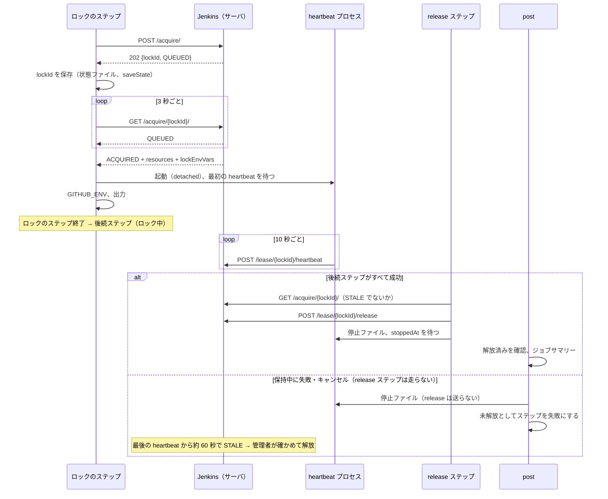

# 設計

[English](design.md) | 日本語

> この文書は [design.md](design.md) の日本語版です。内容が食い違う場合は英語版が正です。

この Action がどう動くか、なぜそうしたかをまとめる。使い方は [README](../README.ja.md)、テストは
[testing.ja.md](testing.ja.md) を見てほしい。マイルストーンや決定に至る経緯は開発記録 [PLAN.md](PLAN.md) にある。

プラグインのファイルへのリンクは upstream master
[`82532cd`](https://github.com/jenkinsci/lockable-resources-plugin/tree/82532cdd3585ebefb06241c04aaf6201b4acb5b3)
（2026-11-23）に固定している。

## 1. 目的とスコープ

lockable-resources プラグインには remote API があり、1 台の Jenkins コントローラ（サーバ）が持つリソース
（実機、検証環境、ライセンスなど）をクライアントに貸し出せる。この Action はその GitHub Actions 用のクライアントである。
ワークフローの要求は Jenkins パイプラインの `lock()` と**同じキュー**に並び、同じ順序規則（priority /
inversePrecedence）と同じ排他で扱われる。

GitHub の `concurrency:` はリポジトリやワークフローの中でしか効かず、Jenkins のことは知らない。
この Action はそれを置き換えるものではない。

やること:

- 1 台のサーバに対する acquire → 待機 → heartbeat → release
- `lock()` のロック選択パラメータ（resource / label / group / quantity / extra ほか）をそのまま渡す
- サーバが返す `lockEnvVars` を後続ステップの環境変数にする
- workflow に明示的に書く release ステップによる解放。保持中にジョブが失敗・キャンセルされたら解放せず、
  サーバ側で STALE にする（§4.1）

やらないこと:

- peer mode（ロックごとに接続先を選ぶ、複数サーバ）。§2 参照
- `shareId`（プラグインでも delegated mode では使えない）
- ジョブをまたぐロック
- サーバ側の操作（リソースの定義、STALE の lease の解放など）。Jenkins の画面で行う

## 2. delegated mode 専用

プラグインのクライアントには 2 つの動作モードがある。

|                                      | peer mode                      | delegated mode                       |
| ------------------------------------ | ------------------------------ | ------------------------------------ |
| 有効化                               | `lock(..., serverId: 'X')`     | `forcedServerId`                     |
| 接続先を決める人                     | パイプライン作者（ロックごと） | 管理者（コントローラにつき 1 つ）    |
| `serverId` を書かない `lock()`       | ローカルのリソースをロック     | 強制先のサーバへ送る                 |
| パイプラインが書いた `serverId`      | そのサーバへ送る               | 無視して強制先へ送る                 |
| `shareId`                            | `serverId` と併用不可          | 使えない                             |

この Action は delegated mode の動作だけを持つ。

1. **接続先は 1 つ**。接続の入力は `server-url` / `username` / `token` だけで、`server-id` は無い。
2. **すべてのロックがその接続先へ行く**。GitHub Actions にはローカルのリソースが無いので、振り替え先も無い。
3. **要求に載せるのはロックの意味を決めるフィールドだけ**。プラグインの `RemoteLockRequest` と同じ線引きで、
   `serverId` / `forcedServerId` は転送の設定であってロックの意味ではない。
4. **`shareId` は受け付けない**。
5. **fail closed**。サーバに届かない、要求が拒否された、といった場合はステップを失敗させ、ロック無しでは先へ進ませない。

Jenkins の `forcedServerId` は管理者の設定で、パイプラインからは外せない。ワークフローでは作者がすべての入力を
書けるので、同じ強制はできない。次の 2 つで近づける。

- **既定の構成**: 接続先 URL とユーザー名を組織（またはリポジトリ）の Variables に置き、Action は入力が空なら
  環境変数から読む（§5.1）。約束であって強制ではない。
- **より強い構成（任意）**: 接続先を固定した薄い composite action を組織の中で公開し、ロックの入力だけを書かせる。
  composite の中で使った JavaScript action の post も走る（[testing.ja.md §3](testing.ja.md#3-ランナーの挙動m0)）。

## 3. 使うサーバ API

ベースパスは `<server-url>/lockable-resources/remote/v1`。認証は Basic（ユーザー名＋API トークン）。
API トークンなら CSRF crumb は要らない（パスワードだと crumb の検査で 403 になる）。

| 用途             | メソッドとパス                   | 主な応答                                                                            |
| ---------------- | -------------------------------- | ----------------------------------------------------------------------------------- |
| 取得要求         | `POST /acquire/`                 | 202 `{lockId, state}`、400 / 403 / 404 / 413、503 `ACQUIRES_PAUSED`                  |
| 状態確認         | `GET /acquire/{lockId}/`         | 200 `{lockId, state, errorCode?, resources?, lockEnvVars?}`、404 `LOCK_NOT_FOUND`   |
| 生存通知         | `POST /lease/{lockId}/heartbeat` | 204、410 `LOCK_STALE`、410 `LOCK_NOT_FOUND`                                         |
| 解放・取り下げ   | `POST /lease/{lockId}/release`   | 204（冪等。QUEUED の要求も取り下げられる）                                         |
| 一覧             | `GET /resources/`                | 使わない（§11）                                                                     |

サーバ側の時間の決まり（クライアントからは変えられない）:

- heartbeat が 60 秒途絶えると **STALE** になる（判定は 1 秒ごと）。STALE は**自動では解放されない**。
  管理者が Jenkins の画面で解放する。
- ただし release エンドポイントは STALE の lease も解放するので、「STALE は管理者のもの」はサーバでは強制されていない。
  lockId と RemoteUse のトークンがあれば外せる。この Action はクライアント側でこれを守る（§4.1）。
- SKIPPED / FAILED の記録は、終わってから 120 秒で消える。
- ポーリングは QUEUED の要求を延命しない。待ちの期限は `timeoutForAllocateResource` だけで決まる。

プラグインのクライアントの定数（[`RemoteClientDefaults`](https://github.com/jenkinsci/lockable-resources-plugin/blob/82532cdd3585ebefb06241c04aaf6201b4acb5b3/src/main/java/org/jenkins/plugins/lockableresources/remote/RemoteClientDefaults.java)）と同じ値を使う。

| 定数                       | 値                                                                                |
| -------------------------- | --------------------------------------------------------------------------------- |
| ポーリング間隔             | 3 秒                                                                              |
| heartbeat 間隔             | 10 秒（`heartbeatIntervalSeconds` としても送る。サーバは検証するだけ）            |
| 1 リクエストのタイムアウト | 5 秒                                                                              |
| ポーリング連続失敗の上限   | 20 回（約 60 秒）                                                                 |

**対応するサーバ版**: 1560.va_b_cd589f23eb_ 以上。`ACQUIRES_PAUSED`、`INVALID_FIELD_VALUE`、`LOCK_STALE` と
状態応答の `resources` がそろうのはこの版から（1554 には `LOCK_STALE` しか無い）。`group` 入力は 1588 以上
（resource groups、#1100）。E2E テストは 1560 と最新版を相手に回している。

**サーバ側の準備**: プラグイン README のとおり。remote API を有効にし、expose label を設定し、
**Overall/Read** と **Lockable Resources/RemoteUse** を持つ専用ユーザーと API トークンを用意する。
E2E テストはこの組み合わせで動いている。RemoteUse の無いユーザーは 403 になる。

## 4. 設計

### 4.1 解放の方針

**解放は workflow に書く release ステップだけが行う。post ステップは解放しない。**

ロックを持っている間にジョブが失敗・キャンセルされたら、Action はリソースを手放さず、heartbeat だけを止める。
サーバは最後の heartbeat から約 60 秒で lease を STALE にする。そのあと管理者が実機を確かめてから、画面で解放する。

失敗したジョブが実機をどんな状態で残したかは、クライアントには分からない。だから次の要求者に渡す前に人が確かめる。
サーバが STALE を自分で解放しない理由（黙ったクライアントがまだハードウェアを動かしているかもしれない）と同じ考え方である。

**Jenkins の `lock()` との違い**: `lock()` は、ブロックが失敗しても終わった時点で解放する。この Action では、
保持中の失敗は STALE になる。

**「保持」の始まり**: ロックのステップが workflow への引き渡しを終えた時点、つまり環境変数と出力を出し、
heartbeat プロセスを起動し、ステップが成功で終わった時点から保持とする。それより前は、どのステップもリソースに
触れていない。キューで待っている（QUEUED）か、引き渡しの前にロックのステップが失敗した場合である。
この段階では、ロックのステップ（ランナーのキャンセルのシグナルを受けたとき）と post ステップが**要求を取り下げる**
（release エンドポイントは QUEUED の要求も取り下げられる）。取り下げないと、要求が後で許可され、heartbeat が無いまま
STALE になり、誰も使っていないリソースのために管理者の手が要る。取り下げの直前に許可されていた場合も release で
解放されるが、同じ理由で問題ない。

**release ステップの `if:` で方針を選べる**:

| release ステップの条件         | 前のステップが失敗・キャンセルされたとき                     |
| ------------------------------ | ------------------------------------------------------------ |
| 指定なし（`success()` と同じ） | release ステップは走らない → STALE（既定・推奨）             |
| `if: always()`                 | 解放される（Jenkins の `lock()` と同じ）                     |

`always()` は、失敗のあとにリソースを確かめる必要がない場合に限って使う。

**すでに STALE になった lease**（たとえば heartbeat プロセスが落ち、後続ステップは成功した場合）: release ステップは
解放の前に `GET /acquire/{lockId}/` で状態を確かめ、STALE なら解放せずに失敗し、管理者に任せる。状態応答は
`state: "STALE"` を返す（プラグインのクライアントでは UNKNOWN になるが、この Action は STALE として読む）。
確かめてから解放するまでの間に STALE になる隙間は残るが、その間も heartbeat は続いているので実際には起きにくい。

### 4.2 ロックの範囲

`lock()` はブロックを囲む。ワークフローのステップは囲めないので、この Action は
**ロックのステップから release ステップまで**をロック範囲にする。release ステップは必須で、書き忘れると
post ステップがジョブを失敗にし、lease は STALE になる。

```yaml
jobs:
  flash:
    runs-on: [self-hosted, lab]
    env:
      LOCKABLE_RESOURCES_SERVER_URL: ${{ vars.LOCKABLE_RESOURCES_SERVER_URL }}
      LOCKABLE_RESOURCES_USERNAME: ${{ vars.LOCKABLE_RESOURCES_USERNAME }}
    steps:
      - uses: kohtaro-satoh/jenkins-lockable-resources-connector@<commit-sha>
        id: lock
        with:
          token: ${{ secrets.LOCKABLE_RESOURCES_TOKEN }}
          label: plc
          quantity: 1
          variable: PLC
          timeout-for-allocate-resource: 30

      - run: ./flash.sh "$PLC0" # ロック中

      # 必須。if: を書かなければ、前のステップが失敗したときは走らず STALE になる
      - uses: kohtaro-satoh/jenkins-lockable-resources-connector/release@<commit-sha>
        with:
          token: ${{ secrets.LOCKABLE_RESOURCES_TOKEN }}
          lock-id: ${{ steps.lock.outputs.lock-id }}

      - run: ./report.sh # 解放後
```

### 4.3 構成要素

| 要素                     | 実体                                              | 役割                                                                                                                                                         |
| ------------------------ | ------------------------------------------------- | ------------------------------------------------------------------------------------------------------------------------------------------------------------ |
| ロックのステップ（main） | `action.yml` の `runs.main`                       | 入力の検証 → acquire → ポーリング → ACQUIRED なら環境変数と出力を出し、heartbeat プロセスを起動して終わる。引き渡し前に失敗・キャンセルされたら要求を取り下げる |
| heartbeat プロセス       | ロックのステップが detached で起動する Node プロセス | 10 秒ごとに heartbeat を送る。ログと状態を `$RUNNER_TEMP` の下に書く                                                                                        |
| release サブアクション   | `release/action.yml`                              | 状態を確かめ、release を送る（一時的な失敗は再送）→ heartbeat プロセスを止める。再送しきれなければ止めて失敗する                                              |
| post                     | `action.yml` の `runs.post`（`post-if: always()`） | **解放しない**。heartbeat プロセスが動いていれば止める（→ STALE）。引き渡し前の要求は取り下げる。保持したまま解放されていなければステップを失敗にする。ジョブサマリーを出す |

release を送ってから heartbeat を止める順にしているのは、短い通信断の間に release を再送している最中も
lease が STALE にならないようにするためである。

**別プロセスにする理由**: JavaScript action のプロセスはステップの終了とともに終わるが、ロックを使うのは
後続のステップである。ステップをまたいで heartbeat を送るには、ステップより長く生きるプロセスが要る。
ランナーは孤児プロセスをジョブの終わり（`Complete job`）でまとめて終了させるので、post ステップが止め損ねても
残り続けることはない。container ジョブでは、代わりにジョブの終わりにコンテナごと消される。どちらも
GitHub ホストランナーで確かめた（[testing.ja.md §3](testing.ja.md#3-ランナーの挙動m0)）。

post ステップが heartbeat を止めるのは、失敗時に確実に STALE にするためでもある。止めなければ、ランナーの片付けまで
heartbeat が続く。

composite action は post を持てないため、JavaScript action にする。

**heartbeat プロセスの起動と停止**:

- 最初の heartbeat は起動直後に送る（プラグインのクライアントは 10 秒後）。ロックのステップはこれを待ち、
  プロセスが起動しなかったとき、またはサーバが 410 を返したときは、引き渡し前の失敗として要求を取り下げる。
- 停止は協調式にする。release / post ステップは停止ファイル（`<lockId>.stop`）を置き、プロセスが状態ファイルに
  `stoppedAt` を書くのを待つ。プロセスは 250 ms ごとに停止ファイルを見て、送信中の heartbeat も打ち切り、
  `stoppedAt` の後は何も送らない。シグナルを送るのは応答が無いときだけで、PID がまだそのプロセスのものか
  （Linux は `/proc/<pid>/cmdline`、macOS は `ps`）を確かめてから送る。PID は再利用されるためである。
  Windows では確かめる手段が無いので送らず、ランナーの片付けに任せる。
- プロセスは環境変数を引き継ぐ（`INPUT_*` と `STATE_*` は除く）。ランナーが孤児プロセスを見つけるための
  `RUNNER_TRACKING_ID` を残すためである。
- 安全網として、lock の状態ファイルが消えたら（`RUNNER_TEMP` はジョブの終わりに空になる）、または段階が
  `enqueued` / `held` 以外になったら自分で止まる。消えたディレクトリを作り直して書き込むことはしない。
- release を送ってから止めるまでの間に heartbeat が出ると 410 `LOCK_NOT_FOUND` が返る。想定どおりなので警告にしない。

### 4.4 シーケンス



### 4.5 ステップ間で受け渡す状態

`core.saveState` は同じ action の main と post の間でしか共有されない。release サブアクションは別の action なので、
ロックのステップはロックごとの状態ファイル `$RUNNER_TEMP/lockable-resources/<lockId>.json` を書き、
release と post はこれを読み書きする。`RUNNER_TEMP` はジョブの終わりに空になる。

状態ファイルに置くもの: 段階（`enqueued` / `held` / `skipped` / `released` / `withdrawn` / `stale`）、
heartbeat プロセスの PID とファイル、取得時刻、書いたステップの `GITHUB_ACTION`、release ステップが失敗したときの理由。
`saveState` には lockId と状態ファイルのパスだけを置く。`stale` は release ステップが STALE を見つけて
手を付けなかった段階である。heartbeat プロセスは別ファイル（`<lockId>.heartbeat.json`）に状態を書く。

- **saveState が post に届かなかったとき**（ロックのステップがキャンセルで殺された場合など）は、post が
  状態ファイルを自分の `GITHUB_ACTION` で探す。この値はジョブの中でステップごとに一意で、main と post で同じである。
  GitHub ホストランナーでは、ロックのステップが殺された場合も含めて saveState はいつも届いた。
- **lockId はサーバが要求を受け付けた直後に保存する**。待機中にキャンセルされても取り下げられるようにするためである。
- **token は保存しない**（state にも状態ファイルにも）。release、post、heartbeat プロセスは入力から読み直す
  （プロセスへはコマンドライン引数ではなく環境変数で渡す。引数だと `ps` で見える）。

## 5. 入力と出力

入力名は GitHub Actions の慣習に合わせて kebab-case にする。

### 5.1 接続

| 入力         | 必須 | 入力が空のとき                     | 説明                                         |
| ------------ | ---- | ---------------------------------- | -------------------------------------------- |
| `server-url` | ○    | `LOCKABLE_RESOURCES_SERVER_URL`    | サーバのルート URL（コンテキストパスを含む） |
| `username`   | ○    | `LOCKABLE_RESOURCES_USERNAME`      | RemoteUse を持つユーザー                     |
| `token`      | ○    | **環境変数からは読まない**         | API トークン。パスワードは不可               |
| `client-id`  |      | `github-actions:<owner>/<repo>`    | サーバの画面でロックの横に出る識別子         |

token だけは環境変数から読まない。ジョブの `env:` に置くと、ほかのすべてのステップ（他者の action を含む）から
見えてしまうためである。

### 5.2 ロックの要求

対応関係と「いつ JSON に載せるか」は、プラグインのクライアント
（[`RemoteApiClient.buildLockRequestJson`](https://github.com/jenkinsci/lockable-resources-plugin/blob/82532cdd3585ebefb06241c04aaf6201b4acb5b3/src/main/java/org/jenkins/plugins/lockableresources/remote/RemoteApiClient.java)）
と同じにする。違いは `priority` と `reason` の 2 か所で、理由は下に書く。単体テストは、このメソッドを写した
参照モデルと入力のすべての組み合わせで突き合わせている。

| 入力                            | `lock()`                     | JSON に載せる条件                                                               | 既定                 |
| ------------------------------- | ---------------------------- | ------------------------------------------------------------------------------- | -------------------- |
| `resource`                      | `resource`                   | 空でない                                                                        | —                    |
| `label`                         | `label`                      | 空でない                                                                        | —                    |
| `group`                         | `group`                      | `group` / `resource` / `label` / `extra` のどれかがあるとき（サーバ 1588 以上） | 空なら `common`      |
| `quantity`                      | `quantity`                   | 正の値                                                                          | 0（合うものすべて）  |
| `variable`                      | `variable`                   | 空でない                                                                        | —                    |
| `inverse-precedence`            | `inversePrecedence`          | 常に                                                                            | `false`              |
| `resource-select-strategy`      | `resourceSelectStrategy`     | 常に                                                                            | `SEQUENTIAL`         |
| `skip-if-locked`                | `skipIfLocked`               | 常に                                                                            | `false`              |
| `extra`                         | `extra`                      | 1 件以上                                                                        | —                    |
| `priority`                      | `priority`                   | **0 以外**（プラグインのクライアントは正の値だけ。§10）                         | 0                    |
| `timeout-for-allocate-resource` | `timeoutForAllocateResource` | 正の値                                                                          | 0（無期限）          |
| `timeout-unit`                  | `timeoutUnit`                | 常に                                                                            | `MINUTES`            |
| `reason`                        | `reason`                     | 常に                                                                            | 空なら補う（下記）   |

- **`group`**: プラグインのクライアントは group を正規化するので、resource / label / extra があれば
  `"group": "common"` を送る。サーバは extra の検証で生の group を見る（resource も label も持たない extra の要素は、
  group が無いと 400 `INVALID_EXTRA`）ので、この Action も同じく送る。1560 のサーバは `group` を読まないので無害である。
- **`resource-select-strategy`** は、サーバと同じく大文字にして送る。
- **`reason`**: 空なら `<workflow> #<run_number> (<job>) <run URL>` を入れる。サーバの画面はリモートのロックの
  clientId と reason を出すので、これが無いと管理者はどの実行が持っているか辿れない。
- **`extra`** は YAML（JSON も可）のリストで、キーは `lock()` の extra と同じ `resource` / `label` / `quantity` /
  `group` だけ。それ以外のキー（`labels` など）はエラーにする。
- **Action が確かめるのは型と書式だけ**（整数、真偽値、`timeout-unit` と `resource-select-strategy` の値、
  `extra` の構文）。組み合わせが妥当か（resource と label の併用、priority と inversePrecedence の併用、対象なし）は
  サーバが決める。対象なしを許すかはサーバの `allowEmptyOrNullValues` 設定にもよる。サーバはローカルの `lock()` と
  同じ文言で 400 `INVALID_REQUEST` を返し、Action はそれを表示する。
- `server-id` / `share-id` という入力は無い。書かれた場合はランナーが想定外の入力として警告する。

### 5.3 出力と環境変数

| 出力        | 内容                                     |
| ----------- | ---------------------------------------- |
| `lock-id`   | サーバが発行した lockId                  |
| `state`     | `ACQUIRED` または `SKIPPED`              |
| `acquired`  | `true` / `false`                         |
| `resources` | ロックしたリソース名の JSON 配列         |
| `env-vars`  | サーバが返した `lockEnvVars` の JSON     |

- `lockEnvVars` の各項目を `GITHUB_ENV` に書く。`variable: PLC` なら `lock()` ブロックと同じく、`PLC`（名前をカンマで
  つないだもの）、`PLC0`、`PLC1` …、`PLC0_<プロパティ名>`、1 つ目のリソースのプロパティとして `PLC_<プロパティ名>`。
  サーバは `variable` を指定したときだけ載せる。
- `variable` が `GITHUB_` / `RUNNER_` で始まる場合はエラーにする。GitHub はこれらの上書きを受け付けない。
- Action はプロパティの値を表示しない。ただしランナーは、`GITHUB_ENV` の変数を後続の各ステップのログの見出しに
  値ごと一覧表示し、マスクもしない（E2E テストで確かめた）。秘密をリソースのプロパティに入れないこと。
  値をマスクするオプションは付けない。マスクした値はログのどこに出ても `***` に置き換わるので、IP アドレスや
  短い値ではログが読めなくなる。

### 5.4 release サブアクション

| 入力                                | 必須 | 説明                                      |
| ----------------------------------- | ---- | ----------------------------------------- |
| `lock-id`                           | ○    | ロックのステップの出力 `lock-id`          |
| `server-url` / `username` / `token` | ○    | §5.1 と同じ（同じ読み替え規則）           |

- `skipped` のロックなら何もせず成功する（SKIPPED の lockId をそのまま渡せるように）。
- まず状態を確かめる。STALE なら解放せずに失敗する（§4.1）。FAILED で errorCode が `RELEASED` なら解放済み
  （管理者が外した、など）として警告だけ出して成功する。404 / 410 ならサーバに記録が無いので警告を出し、
  release は送る（冪等）。
- 状態確認と release の一時的な失敗（応答なし、5xx、408、429）は、3 秒ごとに 20 回（約 60 秒）まで再送する。
  401 や 403 などはすぐ失敗する。
- 状態ファイルが無い場合（別のジョブで取得した lockId など）は release だけを送る。ジョブをまたぐロックは対象外だが、
  手で後片付けする用途には使える。それでも STALE の lease は外さない。

### 5.5 ログとサマリー

- ロックのステップ: 要求の内容、lockId、状態の変化。待機中は 60 秒ごとに経過時間を出す（ポーリングごとには出さない）
- release ステップ: 保持時間、heartbeat の成否の集計
- post ステップ: 未解放の lease があれば、lockId・リソース・STALE になる見込み時刻・管理者の解放が要ることを
  エラーで出す。heartbeat のログの警告と、ジョブサマリーの表も出す

## 6. 失敗時の挙動

プラグインのクライアント（[`RemoteLockSession`](https://github.com/jenkinsci/lockable-resources-plugin/blob/82532cdd3585ebefb06241c04aaf6201b4acb5b3/src/main/java/org/jenkins/plugins/lockableresources/remote/RemoteLockSession.java)）と
同じにするのを原則とし、違う所は意図したものである。

| 事象                                              | プラグインのクライアント             | この Action                                                                                                                              |
| ------------------------------------------------- | ------------------------------------ | ---------------------------------------------------------------------------------------------------------------------------------------- |
| acquire が 4xx                                    | 失敗                                 | 失敗。errorCode とメッセージを出し、よくある原因のヒントを添える                                                                         |
| acquire が 503 `ACQUIRES_PAUSED`                  | allocate の期限まで 3 秒ごとに再送   | 同じ                                                                                                                                     |
| acquire で応答なし・その他の 5xx                  | 失敗（fail closed）                  | 同じ                                                                                                                                     |
| ポーリングで QUEUED                               | 待つ                                 | 同じ                                                                                                                                     |
| ポーリングで ACQUIRED                             | ブロックを実行                       | 環境変数と出力を出し、heartbeat プロセスを起動して成功する                                                                               |
| ポーリングで SKIPPED                              | ブロックを飛ばして成功               | 成功で `acquired=false`。後続ステップは `if:` で判断する（§7）                                                                           |
| ポーリングで FAILED / EXPIRED / UNKNOWN / CANCELLED | 失敗                               | 失敗（`LOCK_WAIT_TIMEOUT` などを表示）                                                                                                   |
| ポーリングで 404 / 410                            | 失敗                                 | 同じ                                                                                                                                     |
| ポーリングの一時的な失敗                          | 連続 20 回で失敗                     | 同じ                                                                                                                                     |
| heartbeat の失敗                                  | 警告して続行                         | heartbeat プロセスが記録して続行。release / post で報告する                                                                              |
| heartbeat が 410（STALE / NOT_FOUND）             | 警告して続行                         | 送るのをやめて記録し、release / post で報告する。STALE から戻る道は無い                                                                  |
| 待機中のキャンセル                                | `stop()` で解放                      | ロックのステップがランナーのシグナルで取り下げる（猶予は約 10 秒、Windows は約 7 秒）。post でも取り下げる（冪等）                       |
| 引き渡し前にロックのステップが失敗                | 解放しない                           | 要求を取り下げる（まだ保持していない。§4.1）                                                                                             |
| **保持中のステップの失敗・キャンセル**            | **ブロックの終わりで解放**           | **解放しない**。post が heartbeat を止め、約 60 秒後に STALE（§4.1。意図した差分）                                                       |
| release ステップの書き忘れ                        | —                                    | post が heartbeat を止めてステップを失敗にする → STALE                                                                                   |
| release の失敗                                    | 警告                                 | release ステップが再送する（その間も heartbeat は続く）。再送しきれなければ heartbeat を止めて失敗する → STALE                           |
| ランナーごと消える                                | —                                    | 何もできない。QUEUED の要求は allocate の期限まで残り、保持中の lease は約 60 秒後に STALE になる                                        |

**ランナーが消える場合への備え**として、`timeout-for-allocate-resource` を付ける。付けておけば、残された QUEUED の要求は
期限で消える。保持中の lease は、保持中の失敗と同じく STALE になる。

## 7. GitHub Actions ならではの制約

- **ロックはジョブの中だけ**。ジョブは別々のランナーで走るので、必要なジョブそれぞれでロックする。
- **release ステップは、ロックが要るすべてのステップの後に置く**。`if:` を書かなければ、失敗のあとは走らず STALE になる（§4.1）。
- **skip-if-locked**: SKIPPED でもロックのステップは成功する。後続ステップは
  `if: steps.lock.outputs.acquired == 'true'` で分ける。release ステップは SKIPPED の lockId を受け付ける。
- **`if: always()` / `if: failure()` のステップは、ロックが取れなかったときも走る**。ロックが要るステップには使わない。
- **同じジョブで同じリソースを 2 回取ると、2 回目が 1 回目を待ち続ける**（`shareId` が無いため）。期限を付ける。
- **複数のロック**: Action を複数回呼び、ロックごとに release ステップを書き、`variable` を別名にする。
- **待ち時間は課金時間とジョブの上限に含まれる**（GitHub ホストランナーは 6 時間）。`timeout-for-allocate-resource` なら
  `LOCK_WAIT_TIMEOUT` ではっきり終わる。ステップの `timeout-minutes` でも止まる（要求は取り下げられる）。
- **ネットワーク**: ランナーからサーバへ届く必要がある。社内の Jenkins なら self-hosted runner を使う。
- **fork からのプルリクエスト**には secrets が渡らない。token が空なら、その旨を出してすぐ失敗する。

## 8. セキュリティ

- token は `token` 入力からだけ受け取り、`core.setSecret` でマスクし、保存せず、heartbeat プロセスへは環境変数で渡す。
- `http://` の URL も動くが、警告を出す（Basic 認証で token が平文で流れる）。閉じた検証環境があるので拒否はしない。
- 自己署名証明書は `NODE_EXTRA_CA_CERTS` で対応する。証明書の検証を切るオプションは無い。
- リダイレクトには従わない（認証情報が付いていき、リダイレクトされた POST は GET に変わる）。代わりにエラーで転送先を示す。
- サーバ側は、Overall/Read と RemoteUse だけを持つ専用ユーザーにする。
- 依存は `@actions/core` と `js-yaml` に絞る。HTTP は Node 標準の `fetch` を使う。
- Action はタグではなくコミット SHA で固定する。

## 9. リポジトリ構成と技術

```
.
├── action.yml                 # ロックのステップ（main + post）
├── release/action.yml         # release ステップ（必須）。runs.main は ../dist/release.js
├── src/
│   ├── entry/                 # バンドルの入口（main / post / release / heartbeat）
│   ├── main.ts                # ロックのステップ: 取得 → 引き渡し、失敗時の取り下げ
│   ├── post.ts                # post ステップ: 段階ごとの判断
│   ├── release.ts             # release サブアクション
│   ├── heartbeat.ts           # heartbeat のループ
│   ├── daemon.ts              # heartbeat プロセスの起動と停止
│   ├── client.ts              # REST クライアント（プラグインの RemoteApiClient 相当）
│   ├── session.ts             # 取得の状態機械（RemoteLockSession 相当）
│   ├── request.ts             # 入力 → lockRequest JSON（buildLockRequestJson 相当）
│   ├── inputs.ts              # 入力の読み取りと検証
│   ├── state.ts               # 保存する状態、状態ファイル
│   ├── retry.ts               # 一時的な失敗の再送
│   ├── io.ts / core-io.ts     # @actions/core の差し替え口
│   └── defaults.ts            # RemoteClientDefaults 相当の定数
├── dist/                      # バンドル（コミットする）
├── __tests__/                 # 単体テストと結合テスト（testing.ja.md）
├── e2e/                       # E2E テストのサーバと道具（testing.ja.md §4）
├── .github/workflows/         # ci.yml、e2e.yml、M0 の PoC ワークフロー
└── docs/                      # 本書、testing、PLAN.md（日本語の開発記録）
```

- TypeScript を Rollup で入口ごとに 1 ファイルにバンドルする。Jest、ESLint、Prettier（`actions/typescript-action` の構成）。
  `runs.using: node24`。
- ライセンス: MIT（プラグインと同じ）。

## 10. プラグイン側の気づき

プラグインのコードを読んで気づいたこと。まだ upstream には報告していない。

1. **負の `priority` がリモート経路で失われる**。プラグインのクライアントは `priority` を正の値のときしか送らない
   （`buildLockRequestJson` の `if (lr.getPriority() > 0)`）。ローカルの `lock()` は負の値を受け付け、サーバも読める。
   そのためリモートでは負の priority が 0 になる。この Action は 0 以外なら送る。
2. **プラグインのクライアントは、ポーリングを諦めたときに要求を取り下げない**。サーバが生きていれば QUEUED の要求が残り、
   後で許可され、heartbeat が無いまま STALE で止まりうる。どのビルドも使っていないリソースに管理者の手が要る。
   この Action は引き渡し前の要求を取り下げる（§4.1）。

## 11. この版に入れないもの

- **包み込み方式**: `run:` 入力でコマンドを受け取り、ロック中に実行して終わったら解放する。heartbeat プロセスは
  要らないが、`uses:` のステップは囲めない。需要があれば追加する。
- **`GET /resources/` を使う補助**: 公開リソースの一覧、取得前の診断（受付停止中のサーバと届かないサーバの区別など）。

## 12. 決定事項

| 日付       | 決定                                                                                              |
| ---------- | ------------------------------------------------------------------------------------------------- |
| 2026-11-24 | release ステップは必須。post は解放しない。保持中の失敗は STALE にする（§4.1）                    |
| 2026-11-25 | 入力名は kebab-case                                                                               |
| 2026-11-25 | `reason` が空なら補う（§5.2）                                                                     |
| 2026-11-25 | 包み込み方式はこの版に入れない（§11）                                                             |
| 2026-11-25 | release の再送は 3 秒ごとに 20 回（§5.4）                                                         |
| 2026-11-25 | release ステップは先に状態を確かめ、STALE の lease は解放しない（§4.1）                           |
| 2026-11-25 | 引き渡し前の要求は取り下げる（§4.1）                                                              |
| 2026-11-26 | プロパティの値はマスクしない（§5.3）                                                              |
| 未決       | 公開先: このリポジトリのまま GitHub Marketplace に出すか、jenkinsci 側に提案するか                |

## 13. 参照

- プラグイン README の remote の節と CasC の例:
  [README.md](https://github.com/jenkinsci/lockable-resources-plugin/blob/82532cdd3585ebefb06241c04aaf6201b4acb5b3/README.md)
- REST API と curl の例:
  [src/doc/examples/remote-api-curl.md](https://github.com/jenkinsci/lockable-resources-plugin/blob/82532cdd3585ebefb06241c04aaf6201b4acb5b3/src/doc/examples/remote-api-curl.md)
- クライアントの状態機械:
  [RemoteLockSession.java](https://github.com/jenkinsci/lockable-resources-plugin/blob/82532cdd3585ebefb06241c04aaf6201b4acb5b3/src/main/java/org/jenkins/plugins/lockableresources/remote/RemoteLockSession.java)
- 要求 JSON の組み立て:
  [RemoteApiClient.java](https://github.com/jenkinsci/lockable-resources-plugin/blob/82532cdd3585ebefb06241c04aaf6201b4acb5b3/src/main/java/org/jenkins/plugins/lockableresources/remote/RemoteApiClient.java)
- peer / delegated の振り分け:
  [RemoteLockRouting.java](https://github.com/jenkinsci/lockable-resources-plugin/blob/82532cdd3585ebefb06241c04aaf6201b4acb5b3/src/main/java/org/jenkins/plugins/lockableresources/remote/RemoteLockRouting.java)
- サーバの REST 実装:
  [RemoteApiV1Action.java](https://github.com/jenkinsci/lockable-resources-plugin/blob/82532cdd3585ebefb06241c04aaf6201b4acb5b3/src/main/java/org/jenkins/plugins/lockableresources/actions/RemoteApiV1Action.java)
- STALE と終端の記録の扱い:
  [RemoteLockManager.java](https://github.com/jenkinsci/lockable-resources-plugin/blob/82532cdd3585ebefb06241c04aaf6201b4acb5b3/src/main/java/org/jenkins/plugins/lockableresources/remote/RemoteLockManager.java)
