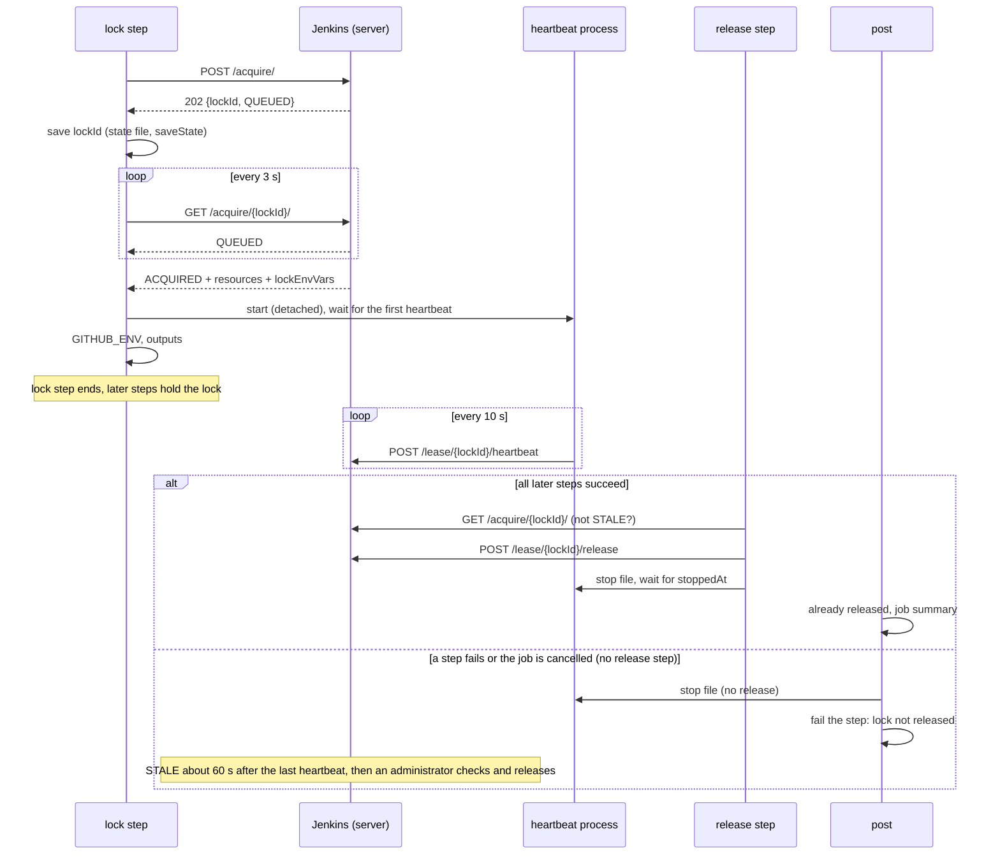

# Design

English | [日本語](design.ja.md)

How the action works and why. For using it, see the [README](../README.md); for
how it is tested, [testing.md](testing.md). The development log (milestones and
how the decisions were reached) is in Japanese in [PLAN.md](PLAN.md).

Plugin files are linked at upstream master
[`82532cd`](https://github.com/jenkinsci/lockable-resources-plugin/tree/82532cdd3585ebefb06241c04aaf6201b4acb5b3)
(2026-11-23).

## 1. Goal and scope

The lockable-resources plugin has a remote API: one Jenkins controller (the
server) lends its resources (hardware, test environments, licenses) to clients.
This action is such a client for GitHub Actions. A workflow's request joins the
**same queue** as the Jenkins pipelines' `lock()` steps, with the same ordering
rules (priority, inversePrecedence) and the same mutual exclusion.

GitHub's `concurrency:` only works within a repository or workflow and knows
nothing about Jenkins; this action does not replace it.

In scope:

- acquire → wait → heartbeat → release against one server
- every `lock()` selector (resource, label, group, quantity, extra, ...) passed
  through unchanged
- the server's `lockEnvVars` as environment variables of later steps
- release by an explicit release step. A lease held when the job fails or is
  cancelled is not released; the server marks it STALE (§4.1)

Out of scope:

- peer mode (choosing a server per lock, several servers); see §2
- `shareId` (the plugin does not allow it in delegated mode either)
- locks that span jobs
- server-side operations (defining resources, releasing STALE leases): those
  stay on the Jenkins pages

## 2. Delegated mode only

The plugin's client has two modes.

|                                    | peer mode                     | delegated mode                         |
| ---------------------------------- | ----------------------------- | -------------------------------------- |
| Turned on by                       | `lock(..., serverId: 'X')`    | `forcedServerId`                       |
| Who chooses the server             | the pipeline author, per lock | the administrator, one per controller  |
| `lock()` without `serverId`        | locks a local resource        | goes to the forced server              |
| `serverId` written in the pipeline | goes to that server           | ignored; goes to the forced server     |
| `shareId`                          | not with `serverId`           | not available                          |

The action has only the delegated behaviour:

1. **One server.** The connection is `server-url` / `username` / `token`;
   there is no `server-id`.
2. **Every lock goes there.** GitHub Actions has no local resources to fall
   back on.
3. **The request carries only what decides the lock**, the same line the
   plugin's `RemoteLockRequest` draws: `serverId` / `forcedServerId` are
   routing, not part of the lock.
4. **No `shareId`.**
5. **Fail closed.** If the server cannot be reached or refuses the request, the
   step fails; nothing proceeds without the lock.

In Jenkins, `forcedServerId` is an administrator setting that pipelines cannot
override. A workflow author writes every input, so the action cannot enforce a
server the same way. Two ways come close:

- **Default set-up:** keep the server URL and user name in organization (or
  repository) variables; the action reads them from the environment when the
  inputs are empty (§5.1). A convention, not enforcement.
- **Stronger (optional):** publish a thin composite action inside the
  organization that fixes the server and only takes the lock inputs. The inner
  action's post step runs inside a composite ([testing.md §3](testing.md#3-runner-behaviour-m0)).

## 3. Server API

Base path `<server-url>/lockable-resources/remote/v1`; Basic authentication
with a user name and an API token. API tokens need no CSRF crumb (a password
fails the crumb check with 403).

| Purpose           | Method and path                  | Main answers                                                                        |
| ----------------- | -------------------------------- | ----------------------------------------------------------------------------------- |
| Request a lock    | `POST /acquire/`                 | 202 `{lockId, state}`; 400 / 403 / 404 / 413; 503 `ACQUIRES_PAUSED`                 |
| Poll              | `GET /acquire/{lockId}/`         | 200 `{lockId, state, errorCode?, resources?, lockEnvVars?}`; 404 `LOCK_NOT_FOUND`   |
| Heartbeat         | `POST /lease/{lockId}/heartbeat` | 204; 410 `LOCK_STALE`; 410 `LOCK_NOT_FOUND`                                         |
| Release, withdraw | `POST /lease/{lockId}/release`   | 204 (idempotent; also withdraws a QUEUED request)                                  |
| List resources    | `GET /resources/`                | not used (§11)                                                                      |

Server timing (clients cannot change it):

- A lease without a heartbeat for 60 s becomes **STALE** (checked every
  second). STALE is **never released automatically**; an administrator
  releases it on the Jenkins page.
- The release endpoint does release STALE leases, so "STALE is for the
  administrator" is not enforced by the server: anyone with the lockId and a
  RemoteUse token could release it. The action enforces it on its side (§4.1).
- SKIPPED / FAILED records are removed 120 s after they end.
- Polling does not extend a QUEUED request; only `timeoutForAllocateResource`
  limits the wait.

The action uses the values of the plugin's client
([`RemoteClientDefaults`](https://github.com/jenkinsci/lockable-resources-plugin/blob/82532cdd3585ebefb06241c04aaf6201b4acb5b3/src/main/java/org/jenkins/plugins/lockableresources/remote/RemoteClientDefaults.java)):

| Constant                           | Value                                                                                 |
| ---------------------------------- | ------------------------------------------------------------------------------------- |
| Poll interval                      | 3 s                                                                                   |
| Heartbeat interval                 | 10 s (also sent as `heartbeatIntervalSeconds`; the server only validates it)          |
| Request timeout                    | 5 s                                                                                   |
| Consecutive poll failures allowed  | 20 (about 60 s)                                                                       |

**Server versions:** 1560.va_b_cd589f23eb_ or later. That release is the first
with `ACQUIRES_PAUSED`, `INVALID_FIELD_VALUE`, `LOCK_STALE` and `resources` in
the poll answer (1554 has only `LOCK_STALE`). The `group` input needs 1588 or
later (resource groups, #1100). The end-to-end tests run against 1560 and the
latest release.

**Server set-up:** as in the plugin README: turn the remote API on, set an
expose label, and create a dedicated user with **Overall/Read** and **Lockable
Resources/RemoteUse** and an API token. That pair is what the end-to-end tests
use; a user without RemoteUse gets 403.

## 4. Design

### 4.1 Release policy

**Only the release step written in the workflow releases. The post step never
does.**

If the job fails or is cancelled while it holds the lock, the action keeps the
resources and only stops the heartbeats. About 60 s after the last heartbeat
the server marks the lease STALE; an administrator checks the hardware and
releases it on the Jenkins page.

The client cannot know what state a failed job left the hardware in, so a
person looks before the next requester gets it. It is the same reason the
server never releases STALE leases by itself: a silent client may still be
driving the hardware.

**Difference from Jenkins `lock()`:** `lock()` releases when its block ends,
even on failure. Here a failure while holding leads to STALE.

**When "holding" starts:** when the lock step has handed the lock over to the
workflow: environment variables and outputs set, heartbeat process started,
and the lock step ended successfully. Before that, no step has touched the
resources: the request is waiting (QUEUED), or the lock step failed before the
hand-over. In that phase the lock step (on the runner's cancel signal) and the
post step **withdraw the request** (the release endpoint also cancels QUEUED
requests). Otherwise the request could be granted later, find no heartbeats,
and go STALE, so that an administrator would have to look at resources nobody
used. If the request was granted just before the withdrawal, the release frees
it, which is safe for the same reason.

**The release step's `if:` chooses the policy:**

| Release step condition         | When an earlier step failed or was cancelled                  |
| ------------------------------ | ------------------------------------------------------------- |
| none (same as `success()`)     | the release step does not run → STALE (default, recommended) |
| `if: always()`                 | released, as Jenkins `lock()` does                            |

Use `always()` only where the resources need no checking after a failure.

**A lease that is already STALE** (for example the heartbeat process died and
the later steps still succeeded): before releasing, the release step asks
`GET /acquire/{lockId}/`; if the state is STALE it fails without releasing and
leaves the lease to the administrator. The poll answer reports `state:
"STALE"` (the plugin's own client maps it to UNKNOWN; this action reads it as
STALE). A lease could still go STALE between that check and the release, but
the heartbeats continue throughout, so it is unlikely in practice.

### 4.2 Lock scope

`lock()` wraps a block. Workflow steps cannot be wrapped, so the lock covers
**the steps from the lock step to the release step**. The release step is
required; without it the post step fails the job and the lease goes STALE.

```yaml
jobs:
  flash:
    runs-on: [self-hosted, lab]
    env:
      LOCKABLE_RESOURCES_SERVER_URL: ${{ vars.LOCKABLE_RESOURCES_SERVER_URL }}
      LOCKABLE_RESOURCES_USERNAME: ${{ vars.LOCKABLE_RESOURCES_USERNAME }}
    steps:
      - uses: kohtaro-satoh/jenkins-lockable-resources-connector@<commit-sha>
        id: lock
        with:
          token: ${{ secrets.LOCKABLE_RESOURCES_TOKEN }}
          label: plc
          quantity: 1
          variable: PLC
          timeout-for-allocate-resource: 30

      - run: ./flash.sh "$PLC0" # holds the lock

      # Required. Without an if:, it does not run after a failure: STALE.
      - uses: kohtaro-satoh/jenkins-lockable-resources-connector/release@<commit-sha>
        with:
          token: ${{ secrets.LOCKABLE_RESOURCES_TOKEN }}
          lock-id: ${{ steps.lock.outputs.lock-id }}

      - run: ./report.sh # lock released
```

### 4.3 Components

| Part                       | Where                                           | Does                                                                                                                                                       |
| -------------------------- | ----------------------------------------------- | ---------------------------------------------------------------------------------------------------------------------------------------------------------- |
| lock step (main)           | `action.yml` `runs.main`                        | checks the inputs → acquire → poll → on ACQUIRED: sets environment variables and outputs, starts the heartbeat process, ends. Withdraws the request if it fails or is cancelled before the hand-over |
| heartbeat process          | detached Node process started by the lock step  | a heartbeat every 10 s; writes its log and status under `$RUNNER_TEMP`                                                                                      |
| release sub-action         | `release/action.yml`                            | checks the state, sends the release (retrying transient failures), then stops the heartbeat process. If the release never gets through, stops it and fails |
| post                       | `action.yml` `runs.post` (`post-if: always()`)  | **never releases.** Stops the heartbeat process if it still runs (→ STALE); withdraws a request not yet handed over; fails the step if a held lock was not released; writes the job summary |

The release step sends the release first and stops the heartbeats afterwards,
so the lease cannot go STALE while a release is being retried through a short
network outage.

**Why a separate process:** a JavaScript action's process ends with its step,
but the steps that use the lock come later. Heartbeats across steps need a
process that outlives the step. The runner terminates orphan processes at the
end of the job (`Complete job`), so a heartbeat process the post step failed to
stop does not live on. In a container job the container is removed at the end
of the job instead. Both were verified on GitHub-hosted runners
([testing.md §3](testing.md#3-runner-behaviour-m0)).

The post step stops the heartbeats so that a failure reliably ends in STALE;
otherwise they would continue until the runner's clean-up.

A composite action cannot have a post step, hence a JavaScript action.

**Starting and stopping the heartbeat process:**

- The first heartbeat goes out at once (the plugin's client waits 10 s). The
  lock step waits for it; if the process does not start, or the server answers
  410, it is a failure before the hand-over and the request is withdrawn.
- Stopping is cooperative. The release and post steps create a stop file
  (`<lockId>.stop`) and wait for the process to write `stoppedAt` to its
  status file. The process checks for the stop file every 250 ms, aborts a
  heartbeat in flight, and sends nothing after `stoppedAt`. A signal is sent
  only if it does not answer, and only after checking that the PID still
  belongs to it (Linux `/proc/<pid>/cmdline`, macOS `ps`), because PIDs are
  reused. Windows has no such check, so no signal is sent there; the runner's
  clean-up remains.
- The process inherits the environment (minus `INPUT_*` and `STATE_*`), which
  keeps `RUNNER_TRACKING_ID`, the variable by which the runner finds orphan
  processes.
- As a safety net it stops by itself when the lock's state file disappears
  (`RUNNER_TEMP` is emptied at the end of the job) or the stage is no longer
  `enqueued` / `held`. It never writes into a directory that is gone.
- A heartbeat sent between the release and the stop gets 410
  `LOCK_NOT_FOUND`. That is expected and not reported as a warning.

### 4.4 Sequence



### 4.5 State passed between steps

`core.saveState` is shared only between the main and post steps of the same
action. The release sub-action is a different action, so the lock step writes
a state file per lock, `$RUNNER_TEMP/lockable-resources/<lockId>.json`, which
the release and post steps read and update. `RUNNER_TEMP` is emptied at the end
of the job.

The state file holds the stage (`enqueued`, `held`, `skipped`, `released`,
`withdrawn`, `stale`), the heartbeat process's PID and files, when the lock was
acquired, the `GITHUB_ACTION` of the step that wrote it, and why the release
step failed if it did. `saveState` holds only the lockId and the state file's
path. `stale` is the stage of a lease the release step found STALE and left
alone. The heartbeat process writes its own status
(`<lockId>.heartbeat.json`).

- **If the saved state does not reach the post step** (for example the lock
  step was killed on cancel), the post step looks for state files with its
  `GITHUB_ACTION`, which is unique per step within a job and the same in main
  and post. On GitHub-hosted runners the saved state always arrived, even when
  the lock step was killed.
- **The lockId is saved as soon as the server accepts the request**, so a
  cancel while waiting can still be withdrawn.
- **The token is never saved**, neither in the state nor in the state file. The
  release and post steps and the heartbeat process read it from the inputs
  (the process from its environment, not its command line, where `ps` would
  show it).

## 5. Inputs and outputs

Input names are kebab-case, as is usual for GitHub Actions.

### 5.1 Connection

| Input        | Required | When empty                                 | Meaning                                            |
| ------------ | -------- | ------------------------------------------ | -------------------------------------------------- |
| `server-url` | yes      | `LOCKABLE_RESOURCES_SERVER_URL`            | the server's root URL, including any context path  |
| `username`   | yes      | `LOCKABLE_RESOURCES_USERNAME`              | the user with RemoteUse                            |
| `token`      | yes      | **not read from the environment**          | API token; a password does not work                |
| `client-id`  |          | `github-actions:<owner>/<repo>`            | shown next to the lock on the server's page        |

Only the token is never read from the environment: in a job-level `env:` it
would be visible to every step, third-party actions included.

### 5.2 Lock request

The mapping, and when a field goes into the JSON, follow the plugin's client
([`RemoteApiClient.buildLockRequestJson`](https://github.com/jenkinsci/lockable-resources-plugin/blob/82532cdd3585ebefb06241c04aaf6201b4acb5b3/src/main/java/org/jenkins/plugins/lockableresources/remote/RemoteApiClient.java)).
The two differences, `priority` and `reason`, are explained below. A unit test
checks the action against a transliteration of that method over every
combination of the inputs.

| Input                           | `lock()`                     | Sent when                                                                 | Default                 |
| ------------------------------- | ---------------------------- | ------------------------------------------------------------------------- | ----------------------- |
| `resource`                      | `resource`                   | not empty                                                                 | —                       |
| `label`                         | `label`                      | not empty                                                                 | —                       |
| `group`                         | `group`                      | any of `group` / `resource` / `label` / `extra` is set (server 1588+)    | `common` when empty     |
| `quantity`                      | `quantity`                   | positive                                                                  | 0 (all matching)        |
| `variable`                      | `variable`                   | not empty                                                                 | —                       |
| `inverse-precedence`            | `inversePrecedence`          | always                                                                    | `false`                 |
| `resource-select-strategy`      | `resourceSelectStrategy`     | always                                                                    | `SEQUENTIAL`            |
| `skip-if-locked`                | `skipIfLocked`               | always                                                                    | `false`                 |
| `extra`                         | `extra`                      | one entry or more                                                         | —                       |
| `priority`                      | `priority`                   | **not 0** (the plugin's client: only positive; §10)                      | 0                       |
| `timeout-for-allocate-resource` | `timeoutForAllocateResource` | positive                                                                  | 0 (wait forever)        |
| `timeout-unit`                  | `timeoutUnit`                | always                                                                    | `MINUTES`               |
| `reason`                        | `reason`                     | always                                                                    | filled in (below)       |

- **`group`:** the plugin's client normalizes the group, so it sends
  `"group": "common"` whenever resource, label or extra is set. The server
  validates extra against the raw group (an extra entry with neither resource
  nor label is 400 `INVALID_EXTRA` without one), so the action does the same.
  Server 1560 ignores `group`, so this is harmless there.
- **`resource-select-strategy`** is sent in upper case, as the server
  interprets it.
- **`reason`:** when empty, `<workflow> #<run_number> (<job>) <run URL>`. The
  server's page shows the clientId and reason of remote locks; without it an
  administrator cannot tell which run holds the lock.
- **`extra`** is a YAML (or JSON) list with the keys of `lock()`'s extra:
  `resource`, `label`, `quantity`, `group`. Any other key (`labels`, ...) is an
  error.
- **The action checks types and formats only** (integers, booleans, the
  `timeout-unit` and `resource-select-strategy` values, the `extra` syntax).
  Whether a combination makes sense (resource and label together, priority
  with inversePrecedence, no target at all) is the server's decision; whether
  "no target" is allowed even depends on its `allowEmptyOrNullValues` setting.
  The server answers 400 `INVALID_REQUEST` with the same message as a local
  `lock()`, and the action shows it.
- There are no `server-id` / `share-id` inputs; the runner warns about
  unexpected inputs if a workflow sets them.

### 5.3 Outputs and environment variables

| Output      | Content                                   |
| ----------- | ----------------------------------------- |
| `lock-id`   | the lockId the server issued              |
| `state`     | `ACQUIRED` or `SKIPPED`                   |
| `acquired`  | `true` / `false`                          |
| `resources` | JSON array of the locked resource names   |
| `env-vars`  | JSON object of the server's `lockEnvVars` |

- Every entry of `lockEnvVars` goes into `GITHUB_ENV`: with `variable: PLC`,
  `PLC` (comma-separated names), `PLC0`, `PLC1`, ..., `PLC0_<property>`, and
  `PLC_<property>` for the first resource's properties, as in a `lock()`
  block. The server sends them only when `variable` is set.
- A `variable` starting with `GITHUB_` or `RUNNER_` is an error: GitHub does
  not let a step overwrite those.
- The action never prints property values. The runner, however, lists every
  `GITHUB_ENV` variable with its value in the log header of each later step,
  unmasked (seen in the end-to-end tests). Keep secrets out of resource
  properties. There is no option to mask them: a masked value is replaced by
  `***` wherever it appears in the log, which makes logs unreadable for values
  like IP addresses or short strings.

### 5.4 Release sub-action

| Input                               | Required | Meaning                               |
| ----------------------------------- | -------- | ------------------------------------- |
| `lock-id`                           | yes      | the lock step's `lock-id` output      |
| `server-url` / `username` / `token` | yes      | as in §5.1, with the same fallbacks   |

- A `skipped` lock: nothing to do, success (so the SKIPPED lockId can be
  passed as is).
- First it checks the state: STALE → fails without releasing (§4.1). FAILED
  with errorCode `RELEASED` → already released (by an administrator, say):
  warning, success. 404 / 410 → the server has no record: warning, and the
  release is sent anyway (it is idempotent).
- Transient failures (no answer, 5xx, 408, 429) of the check and of the
  release are retried every 3 s, up to 20 times (about 60 s). Anything else,
  such as 401 or 403, fails at once.
- Without a state file (a lockId from another job, say) only the release is
  sent. Locks across jobs are not supported, but this helps cleaning up by
  hand. STALE leases are still not released.

### 5.5 Logs and summary

- Lock step: the request, the lockId, state changes; the elapsed time every
  60 s while waiting (not every poll).
- Release step: how long the lock was held, heartbeat counts.
- Post step: for a lease left unreleased, an error with the lockId, the
  resources, when it will become STALE and that an administrator must release
  it; warnings from the heartbeat log; a table in the job summary.

## 6. Failure handling

The principle is to behave like the plugin's client
([`RemoteLockSession`](https://github.com/jenkinsci/lockable-resources-plugin/blob/82532cdd3585ebefb06241c04aaf6201b4acb5b3/src/main/java/org/jenkins/plugins/lockableresources/remote/RemoteLockSession.java));
the differences are deliberate.

| Event                                             | Plugin's client                     | This action                                                                                                                                          |
| ------------------------------------------------- | ----------------------------------- | ---------------------------------------------------------------------------------------------------------------------------------------------------- |
| acquire answers 4xx                               | fails                               | fails, showing the errorCode and message, with a hint for common causes                                                                              |
| acquire answers 503 `ACQUIRES_PAUSED`             | retries every 3 s until the allocation deadline | same                                                                                                                                      |
| acquire: no answer, other 5xx                     | fails (fail closed)                 | same                                                                                                                                                 |
| poll: QUEUED                                      | waits                               | same                                                                                                                                                 |
| poll: ACQUIRED                                    | runs the block                      | sets variables and outputs, starts the heartbeat process, succeeds                                                                                   |
| poll: SKIPPED                                     | skips the block, succeeds           | succeeds with `acquired=false`; later steps decide with `if:` (§7)                                                                                    |
| poll: FAILED / EXPIRED / UNKNOWN / CANCELLED      | fails                               | fails (naming `LOCK_WAIT_TIMEOUT` and the like)                                                                                                      |
| poll: 404 / 410                                   | fails                               | same                                                                                                                                                 |
| poll: transient failure                           | fails after 20 in a row             | same                                                                                                                                                 |
| heartbeat fails                                   | warns, continues                    | the heartbeat process logs it and continues; release / post report it                                                                                |
| heartbeat answers 410 (STALE / NOT_FOUND)         | warns, continues                    | stops sending and records it; release / post report it. Nothing comes back from STALE                                                               |
| cancelled while waiting                           | `stop()` releases                   | the lock step withdraws on the runner's signal (it has about 10 s, 7 s on Windows); the post step withdraws again (idempotent)                       |
| lock step fails before the hand-over              | does not release                    | withdraws the request (not held yet, §4.1)                                                                                                          |
| **a step fails or the job is cancelled while held** | **releases at the end of the block** | **does not release.** Post stops the heartbeats; STALE about 60 s later (§4.1, deliberate)                                                        |
| no release step in the workflow                   | —                                   | post stops the heartbeats and fails the step → STALE                                                                                                |
| release fails                                     | warns                               | the release step retries (heartbeats continue); if it never gets through, it stops the heartbeats and fails → STALE                                 |
| the runner disappears                             | —                                   | nothing can be done: a QUEUED request stays until its allocation deadline; a held lease goes STALE after about 60 s                                 |

**Against a disappearing runner**, set `timeout-for-allocate-resource`: a
QUEUED request left behind then expires by itself. A held lease goes STALE like
any failure while holding.

## 7. GitHub Actions constraints

- **A lock lives within one job.** Jobs run on different runners; lock in each
  job that needs it.
- **Put the release step after every step that needs the lock.** Without an
  `if:` it does not run after a failure, and the lease goes STALE (§4.1).
- **skip-if-locked:** the lock step succeeds when SKIPPED; guard later steps
  with `if: steps.lock.outputs.acquired == 'true'`. The release step accepts
  the SKIPPED lockId.
- **`if: always()` / `if: failure()` steps also run when the lock was not
  acquired.** Do not use them for steps that need the lock.
- **Locking the same resource twice in one job makes the second request wait
  for the first** (there is no `shareId`). Set a timeout.
- **Several locks:** call the action several times, with a release step per
  lock and a different `variable` each.
- **Waiting counts towards billing and the job's time limit** (6 h on
  GitHub-hosted runners). `timeout-for-allocate-resource` ends the wait with a
  clear `LOCK_WAIT_TIMEOUT`; a step `timeout-minutes` works too (the request is
  withdrawn).
- **Network:** the runner must reach the server; for an internal Jenkins, use
  a self-hosted runner.
- **Pull requests from forks** get no secrets; with an empty token the action
  says so and fails at once.

## 8. Security

- The token comes only from the `token` input, is masked with
  `core.setSecret`, is never saved, and reaches the heartbeat process through
  its environment.
- `http://` URLs work but print a warning: Basic authentication sends the
  token in clear text. (Closed test networks exist, so they are not refused.)
- Self-signed certificates: `NODE_EXTRA_CA_CERTS`. There is no option to turn
  certificate checks off.
- Redirects are not followed (the credentials would go along, and a redirected
  POST would turn into a GET); the error names the target instead.
- On the server, use a dedicated user with Overall/Read and RemoteUse only.
- Dependencies are kept to `@actions/core` and `js-yaml`; HTTP is Node's own
  `fetch`.
- Pin the action to a commit SHA rather than a tag.

## 9. Repository layout and tooling

```
.
├── action.yml                 # lock step (main + post)
├── release/action.yml         # release step (required); runs.main is ../dist/release.js
├── src/
│   ├── entry/                 # bundle entry points (main / post / release / heartbeat)
│   ├── main.ts                # lock step: acquire → hand over; withdraw on failure
│   ├── post.ts                # post step: what to do per stage
│   ├── release.ts             # release sub-action
│   ├── heartbeat.ts           # the heartbeat loop
│   ├── daemon.ts              # starting and stopping the heartbeat process
│   ├── client.ts              # REST client (like the plugin's RemoteApiClient)
│   ├── session.ts             # acquire state machine (like RemoteLockSession)
│   ├── request.ts             # inputs → lockRequest JSON (like buildLockRequestJson)
│   ├── inputs.ts              # reading and checking the inputs
│   ├── state.ts               # saved state, state files
│   ├── retry.ts               # retrying transient failures
│   ├── io.ts / core-io.ts     # @actions/core behind an interface
│   └── defaults.ts            # the RemoteClientDefaults constants
├── dist/                      # bundles (committed)
├── __tests__/                 # unit and integration tests (testing.md)
├── e2e/                       # end-to-end test server and tools (testing.md §4)
├── .github/workflows/         # ci.yml, e2e.yml, the M0 proof-of-concept workflows
└── docs/                      # this document, testing.md, PLAN.md (Japanese log)
```

- TypeScript, bundled by Rollup into one file per entry point; Jest, ESLint,
  Prettier (the `actions/typescript-action` layout). `runs.using: node24`.
- License: MIT, like the plugin.

## 10. Notes on the plugin

Found while reading the plugin's code; not yet reported upstream.

1. **A negative `priority` is lost on the remote path.** The plugin's client
   sends `priority` only when it is positive (`if (lr.getPriority() > 0)` in
   `buildLockRequestJson`), while a local `lock()` accepts negative values and
   the server reads them. Remotely, a negative priority becomes 0. This action
   sends any non-zero value.
2. **The plugin's client does not withdraw a request when it gives up
   polling.** If the server is alive, the QUEUED request stays, may be granted
   later, gets no heartbeats and stops at STALE, so an administrator has to
   look at resources no build used. This action withdraws requests that were
   not handed over (§4.1).

## 11. Not in this version

- **Wrapping mode:** a `run:` input executed while the lock is held, released
  when it ends. No heartbeat process needed, but `uses:` steps cannot be
  wrapped. Added if there is demand.
- **`GET /resources/` helpers:** listing exposed resources, diagnosing before
  acquiring (telling a paused server from an unreachable one).

## 12. Decisions

| Date       | Decision                                                                                                       |
| ---------- | -------------------------------------------------------------------------------------------------------------- |
| 2026-11-24 | The release step is required; the post step never releases; a failure while holding ends in STALE (§4.1)      |
| 2026-11-25 | Input names are kebab-case                                                                                     |
| 2026-11-25 | An empty `reason` is filled in (§5.2)                                                                          |
| 2026-11-25 | No wrapping mode in this version (§11)                                                                         |
| 2026-11-25 | Release retries: every 3 s, 20 times (§5.4)                                                                    |
| 2026-11-25 | The release step checks the state first and does not release a STALE lease (§4.1)                             |
| 2026-11-25 | Requests not yet handed over are withdrawn (§4.1)                                                              |
| 2026-11-26 | Property values are not masked (§5.3)                                                                          |
| open       | Where to publish: the GitHub Marketplace from this repository, or a proposal to jenkinsci                      |

## 13. References

- The plugin README's remote section and CasC example:
  [README.md](https://github.com/jenkinsci/lockable-resources-plugin/blob/82532cdd3585ebefb06241c04aaf6201b4acb5b3/README.md)
- REST API with curl:
  [src/doc/examples/remote-api-curl.md](https://github.com/jenkinsci/lockable-resources-plugin/blob/82532cdd3585ebefb06241c04aaf6201b4acb5b3/src/doc/examples/remote-api-curl.md)
- The client's state machine:
  [RemoteLockSession.java](https://github.com/jenkinsci/lockable-resources-plugin/blob/82532cdd3585ebefb06241c04aaf6201b4acb5b3/src/main/java/org/jenkins/plugins/lockableresources/remote/RemoteLockSession.java)
- Building the request JSON:
  [RemoteApiClient.java](https://github.com/jenkinsci/lockable-resources-plugin/blob/82532cdd3585ebefb06241c04aaf6201b4acb5b3/src/main/java/org/jenkins/plugins/lockableresources/remote/RemoteApiClient.java)
- Peer and delegated routing:
  [RemoteLockRouting.java](https://github.com/jenkinsci/lockable-resources-plugin/blob/82532cdd3585ebefb06241c04aaf6201b4acb5b3/src/main/java/org/jenkins/plugins/lockableresources/remote/RemoteLockRouting.java)
- The server's REST implementation:
  [RemoteApiV1Action.java](https://github.com/jenkinsci/lockable-resources-plugin/blob/82532cdd3585ebefb06241c04aaf6201b4acb5b3/src/main/java/org/jenkins/plugins/lockableresources/actions/RemoteApiV1Action.java)
- STALE and terminal records:
  [RemoteLockManager.java](https://github.com/jenkinsci/lockable-resources-plugin/blob/82532cdd3585ebefb06241c04aaf6201b4acb5b3/src/main/java/org/jenkins/plugins/lockableresources/remote/RemoteLockManager.java)
